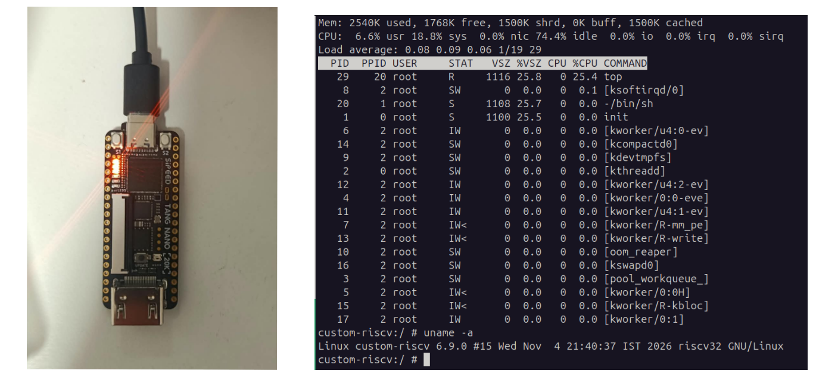
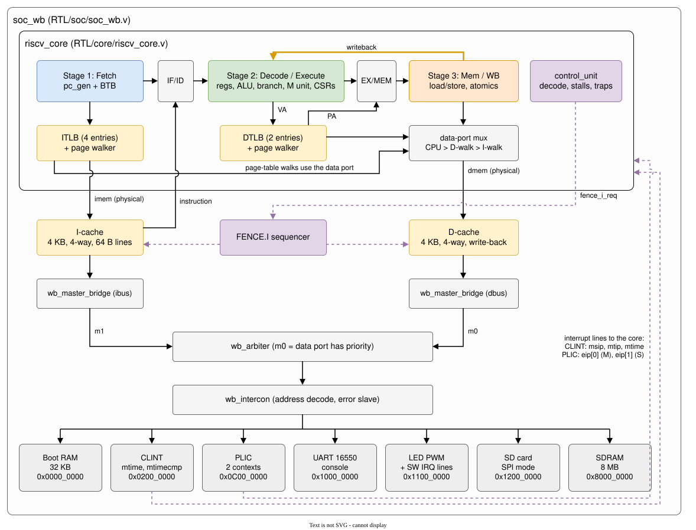

# Beresheet



Beresheet is a RISC-V processor and system-on-chip written from scratch in Verilog. It runs on
a Sipeed Tang Nano 20K FPGA board and boots **Linux 6.9** through **OpenSBI** to an interactive
**BusyBox** shell, on the board and in simulation.

```
beresheet:/ # uname -a
Linux beresheet 6.9.0 riscv32 GNU/Linux
beresheet:/ # cat /proc/cpuinfo
isa  : rv32ima_zicntr_zicsr_zifencei
mmu  : sv32
```

The repository is also a course: [`doc/arch/`](doc/arch/README.md) is a book that explains
the machine from the top-level architecture down to the RTL.

## At a glance

| | |
|---|---|
| ISA | RV32IMA, Zicsr, Zicntr, Zifencei |
| Privilege | Machine, Supervisor and User modes; Sv32 virtual memory (ITLB 4 entries, DTLB 2 entries, hardware page walker) |
| Pipeline | 3 stages (Fetch, Decode/Execute, Memory/Writeback) with a branch target buffer |
| Caches | 4 KB instruction and 4 KB data cache, 4-way, 64-byte lines, write-back D-cache |
| Bus | Wishbone B4 (classic) with arbiter and address decoder |
| Peripherals | CLINT, PLIC, UART 16550, SD card (SPI), LED PWM, 8 MB SDRAM controller |
| Board | Tang Nano 20K (Gowin GW2AR-18), 24 MHz, about 60% of the logic |



The core has one instruction port and one data port; the caches, bus and devices around it
are the SoC. [Chapter 0](doc/arch/core/00-overview.md) of the book walks through the diagram.

## Repository layout

```
RTL/core/          the processor: pipeline, CSRs and traps, MMU and TLBs, caches, mul/div
RTL/bus/           Wishbone master bridge, arbiter, interconnect, boot RAM
RTL/soc/           soc_wb.v: the SoC top level and memory map
RTL/peripherals/   CLINT, PLIC, UART 16550, SD card, SDRAM, LED PWM
RTL/fpga/<board>/  board top level, pin and timing constraints, Gowin build script
RTL/sim/fast/      fast_sim: core-only C++/Verilator simulator
RTL/sim/soc/       full-SoC testbench with SDRAM and SD card models
RTL/sim/unit/      unit testbenches: PLIC, data cache, MMU
tests/rv32i/       directed ISA tests (functional and trap tests)
firmware/bios/     boot-RAM BIOS: UART, memory test, SD/FAT32 loader, OpenSBI handoff
firmware/dts/      device tree
firmware/linux/    kernel config, Buildroot defconfig, BusyBox fragment, initramfs files
software/          bare-metal SDK (crt0, linker scripts) and examples
scripts/           image conversion, boot-map check, SD image, serial console
mk/                Makefile fragments; mk/boards/ holds one file per FPGA board
doc/arch/          the book: core, bus, peripherals
doc/images/        pictures used by this README
```

Everything generated goes to `build/`. The `schematics/` directory is the working area for
draw.io sources and is not tracked; every figure in `doc/` is an SVG with the diagram embedded,
so it opens directly in draw.io for editing.

## Installation

You need a RISC-V cross compiler, Verilator and a C++ compiler for the simulators, and QEMU
for the reference model. The FPGA tools and the Linux build are optional and covered below.
These commands were verified in clean containers (see [Verified setups](#verified-setups)).

### Ubuntu 24.04 / Debian

```sh
sudo apt install build-essential git python3 verilator device-tree-compiler \
    fdisk dosfstools gcc-riscv64-unknown-elf gcc-riscv64-linux-gnu \
    qemu-system-misc gdb-multiarch tio openfpgaloader
```

### Fedora

```sh
sudo dnf install make gcc gcc-c++ git python3 verilator dtc \
    util-linux dosfstools gcc-riscv64-linux-gnu binutils-riscv64-linux-gnu \
    qemu-system-riscv gdb tio
```

Fedora does not package openFPGALoader, which is only needed to program the board. Build it
from [source](https://github.com/trabucayre/openFPGALoader) if you need `load` or `flash`.

### Arch Linux

```sh
sudo pacman -S base-devel git python verilator dtc dosfstools \
    riscv64-elf-gcc riscv64-linux-gnu-gcc \
    qemu-system-riscv riscv64-elf-gdb picocom openfpgaloader
```

### What each package is for

| Tool | Used by |
|---|---|
| `riscv64-*-gcc` (bare-metal or Linux target) | BIOS, tests, `compile-bin`. The prefix is detected automatically (`riscv64-unknown-elf-`, `riscv64-elf-`, `riscv64-linux-gnu-`); override with `CROSS=`. |
| `riscv64-linux-gnu-gcc` | OpenSBI, which must be linked as a position-independent executable; bare-metal `*-elf` linkers cannot do that. |
| Verilator 5.020 or newer, g++ | `fast_sim`, `sim`, unit tests, lint |
| `dtc` / `fdtput` | device tree |
| `sfdisk`, `mkfs.vfat` | the simulated FAT32 SD card used by `sim` and `test-soc` |
| `qemu-system-riscv32`, gdb | `qemu`, `qemu-gdb`, `gdb` |
| `tio`, `picocom` or `minicom` | `console` on the board |
| `openFPGALoader` | `load`, `flash` |

### FPGA tools (to build a bitstream)

Gowin EDA is not packaged by distributions. Download **Gowin EDA Education** for Linux from
[gowinsemi.com](https://www.gowinsemi.com) (tested with 1.9.11), unpack it, and point the
build at it, or put `gw_sh` on your `PATH`:

```sh
make synth GOWIN_HOME=/opt/gowin/IDE
```

### Linux images (optional)

The kernel and the BusyBox root file system are built with
[Buildroot](https://buildroot.org) 2026.02. Buildroot needs its usual host packages
(`cpio unzip rsync bc wget file perl patch` and, on Ubuntu, `libncurses-dev`). Download and
unpack it, then:

```sh
make linux-toolchain BUILDROOT=~/buildroot-2026.02   # musl toolchain + kernel source, long, once
make linux-kernel linux-rootfs dtb compile-openSBI   # Image, initramfs, DTB, fw_dynamic.bin
make sdcard                                          # build/sdcard/: BOOT.TXT and the images
```

## Quick start with the release binaries

The [releases page](https://github.com/VladislavPerepelichnyi/Beresheet_core/releases) has a
prebuilt Linux boot set and a Tang Nano 20K bitstream, so you can boot Linux without
Buildroot or the Gowin tools. After installing the packages above:

```sh
git clone https://github.com/VladislavPerepelichnyi/Beresheet_core.git && cd Beresheet_core
# download compiled_Beresheet.tar from the latest release into this directory, then:
tar xf compiled_Beresheet.tar
```

| Path in the archive | Contents |
|---|---|
| `compiled_binaries/` | the SD card boot set: `BOOT.TXT`, `fw_dynamic.bin` (OpenSBI), `Image` (Linux), `custom.dtb` (device tree), `rootfs.gz` (BusyBox initramfs), `MANIFEST.md5` |
| `FPGA_prebuild/tangnano20k/beresheet.fs` | bitstream with the BIOS in boot RAM |

### Boot Linux in the simulator

```sh
make fast_sim BIN=compiled_binaries/BOOT.TXT
```

The first run builds the simulator with Verilator (about a minute). Your terminal is then
the console: the kernel log appears at once and the shell prompt after about 35 seconds.
Press **Ctrl-A x** to quit.

### Boot Linux on the board

**1. Prepare the SD card.** The BIOS reads a FAT32 file system on a card with an MBR
(DOS) partition table, from an SD version 2 or SDHC card. Find the card's device with
`lsblk` and check its size: everything on it is erased. It is `/dev/sdX` in a USB reader
(partition `/dev/sdX1`) and `/dev/mmcblk0` in a built-in slot (partition `/dev/mmcblk0p1`).

```sh
lsblk                                                   # find the card
sudo umount /dev/sdX?*                                  # if the desktop mounted it
printf 'label: dos\nstart=2048, type=c\n' | sudo sfdisk /dev/sdX   # MBR, one FAT32 (LBA) partition
sudo mkfs.vfat -F 32 -n BOOT /dev/sdX1                  # FAT32 file system
```

**2. Copy the boot set** to the root of the partition and check it:

```sh
sudo mount /dev/sdX1 /mnt
sudo cp compiled_binaries/* /mnt/
(cd /mnt && md5sum -c "$OLDPWD/compiled_binaries/MANIFEST.md5")   # every line must say OK
sudo umount /mnt
```

A card you prepared once only needs step 2 for new images. With images you built yourself,
`make sdcard` stages them in `build/sdcard/` and `make sdcard-verify SD=/mnt` does the check.

**3. Program the FPGA and open the console.** Insert the card, connect the board by USB, and:

```sh
make load  FS=FPGA_prebuild/tangnano20k/beresheet.fs   # FPGA SRAM: until power-off
make flash FS=FPGA_prebuild/tangnano20k/beresheet.fs   # or on-board flash: kept across power cycles
make console                                           # PORT=/dev/ttyUSB1, 38400 baud
```

The BIOS tests the SDRAM, reads `BOOT.TXT`, loads the images and starts OpenSBI, which
starts Linux; each step reports on the console. Press the board's reset button to reboot.
Open the console after programming: the USB adapter is reset while the FPGA is programmed,
which can leave a terminal opened earlier at the wrong speed. `FS=` takes any `.fs` file; without it, `load` and `flash` program
the bitstream from `make synth`. The serial port needs your user in the `dialout` group
(`uucp` on Arch), and programming over USB may need the openFPGALoader udev rules.

## Using it

Run `make` (or `make help`) for the full menu with the current value of every variable.

### Simulation

```sh
make test                                   # all regression tests (about two minutes)
make fast_sim BIN=build/sdcard/BOOT.TXT     # boot Linux on the core-only simulator
make sim      BIN=build/bin/hello.elf       # run a program on the full SoC
```

| Target | What is simulated | Use it for |
|---|---|---|
| `fast_sim BIN=` | The processor only (pipeline, CSRs, MMU, TLBs). Memory is a plain array; CLINT, PLIC and UART are functional C++ models; the console is your terminal. About 2.4 M cycles/s; Linux reaches the shell in about 35 s. | Software bring-up, booting Linux, ISA tests |
| `sim BIN=` | The whole SoC: core, caches, Wishbone bus, CLINT, PLIC, UART RTL, SDRAM and SD-card models. About 70 k cycles/s. | System verification: bus timing, caches, peripherals |

`BIN` is a bare-metal ELF or raw binary, or a `BOOT.TXT` boot descriptor: the same file the
BIOS reads from the SD card on the board, listing the OpenSBI, kernel, device tree and
initramfs images and their load addresses. Neither simulator has a timeout; `MAX_CYCLES=N`
sets an optional limit. In `fast_sim`, press **Ctrl-A x** to quit.

| Test target | Contents |
|---|---|
| `test-isa` | directed ISA, privilege, MMU and trap tests on `fast_sim`, with pipeline invariant checks |
| `test-units` | PLIC, data cache and MMU unit testbenches |
| `test-soc` | the same directed tests and the BIOS self-test on the full SoC |
| `lint` | Verilator `-Wall` over the core and the SoC |

### Software

```sh
make compile-bios                                        # boot-RAM BIOS for the board
make compile-bin SRC=software/examples/hello/hello.c     # your own bare-metal program
make compile-openSBI                                     # OpenSBI fw_dynamic at 0x80700000
```

`compile-bin` links for the 32 KB boot RAM at `0x0` by default (`LINK=boot`), or for SDRAM at
`0x80000000` with `LINK=sdram`. A program ends by executing `ebreak` with `mtvec` cleared; `a0`
is its exit status in both simulators.

### Hardware

```sh
make synth                      # bitstream: build/fpga/impl/pnr/beresheet.fs
make load  [FS=<file.fs>]       # program the FPGA SRAM (lost at power-off)
make flash [FS=<file.fs>]       # program the on-board flash
make console                    # serial console, PORT=/dev/ttyUSB1 BAUD=38400
```

| Variable | Meaning |
|---|---|
| `FPGA=tangnano20k` | Target board, from `mk/boards/`. The Tang Mega 138K Pro is reserved and not supported yet. |
| `FS=<file.fs>` | Bitstream for `load` and `flash`, such as the release download. Without it they program the output of `make synth`, rebuilding it first if it is stale. |
| `BIOS_BR=<elf or bin>` | Put this program in boot RAM instead of the BIOS (hard-wired firmware). It must fit in 32 KB at `0x0`. |
| `INCL_PER=ethernet,hdmi,usb,pcie` | Optional peripherals. Address slots are reserved (`0x1300_0000` to `0x1600_0000`), none is implemented yet, and requesting one stops the build with a clear message. |

To boot your own Linux build on the board, prepare the card as in the
[quick start](#boot-linux-on-the-board) and copy the files from `build/sdcard/` instead.

### Tools

```sh
make disassembler BIN=build/bin/hello.elf               # objdump for this CPU
make compile-bin SRC=software/examples/hello/hello.c LINK=sdram
make qemu BIN=build/bin/hello.elf                       # reference behaviour on QEMU
make qemu-gdb BIN=...    # then, in another terminal: make gdb BIN=...
make translate_bin_to_vmem BIN=prog.bin OUT=prog.vmem   # $readmemh image for boot RAM
```

`qemu` runs QEMU's `virt` machine with the CPU restricted to exactly this core's extensions
(`-cpu rv32` with every other extension disabled). Its CLINT, PLIC and UART are at the same
addresses as ours, so the same SDRAM-linked binaries and the same `BOOT.TXT` run on both,
which makes QEMU a reference to compare against.

## Documentation

[`doc/arch/README.md`](doc/arch/README.md) is the index of the book:

- **Part I, the core:** overview, ISA and instruction formats, the pipeline, the M and A
  extensions, privilege and traps, virtual memory and TLBs, caches, counters, the boot
  sequence, and limitations.
- **Part II, the bus:** Wishbone basics, the master bridge, arbitration and bus locking, the
  interconnect, the memory map, boot RAM and SDRAM.
- **Part III, peripherals and interrupts:** CLINT, PLIC, UART 16550, LED PWM, SD card, and the
  interrupt path from a device to the trap handler.

For the fundamentals of RV32I and pipelined processors, the book refers to Sarah L. Harris and
David Harris, *Digital Design and Computer Architecture: RISC-V Edition* (Morgan Kaufmann,
2021).

## Verified setups

The installation commands above were tested in clean containers: Ubuntu and Fedora with
[distrobox](https://distrobox.it), Arch with plain Podman (distrobox 1.7 cannot initialise
current Arch images). In each one, `make test` (the ISA, unit and SoC tests), `compile-bios`,
`compile-openSBI`, `compile-bin`, `disassembler`, `sim`, `fast_sim` and `qemu` were run from a
fresh clone:

| Distribution | Compiler prefix | Verilator | QEMU |
|---|---|---|---|
| Ubuntu 24.04 | `riscv64-unknown-elf-` | 5.020 | 8.2 |
| Fedora 43 | `riscv64-linux-gnu-` | 5.046 | 10.1 |
| Arch Linux | `riscv64-elf-` | 5.054 | 11.1 |

The Gowin synthesis and the Buildroot Linux build were verified on the development machine
(Ubuntu 24.04).

## What is original and what is borrowed

### Developed for this project

- **The processor core** (`RTL/core/`): pipeline, hazard handling, decoder, ALU, branch unit,
  multiplier and divider, CSR unit and traps, atomics, the Sv32 MMU and TLBs, and the caches.
- **The Wishbone fabric** (`RTL/bus/`) and **the SoC** (`RTL/soc/`).
- **CLINT** and **LED PWM**, and the Wishbone wrappers around the borrowed SD-card and SDRAM
  controllers.
- **Both simulators**, every testbench and model, and the test suite.
- **The BIOS**, the device tree, and the Linux, Buildroot and BusyBox configuration.
- **The board top level**, the constraints, the build system and the documentation.

### Borrowed or adapted

| Component | Origin | License | Changes |
|---|---|---|---|
| UART 16550 (`RTL/peripherals/uart16550/`, except `uart_wb_slave.v`) | OpenCores `uart16550` | LGPL-2.1 | `LITLE_ENDIAN` defined so registers sit at little-endian byte addresses |
| SD-card SPI controller (`RTL/peripherals/sdcard/`, except `sdspi_wb.v` and `nettype_restore.v`) | [ZipCPU/sdspi](https://github.com/ZipCPU/sdspi), Dan Gisselquist | GPL-3.0 | None |
| SDRAM controller (`sdram_core.v`) | [nand2mario/sdram-tang-nano-20k](https://github.com/nand2mario/sdram-tang-nano-20k) | Apache-2.0 | 32-bit write port with byte mask |
| PLIC (`plic_wb.v`) | Derived from an AXI4-Lite PLIC | (to be credited) | Rewritten for Wishbone; claim/complete, pending and gateway behaviour follow the specification |
| PLL wrapper (`gowin_rpll.v`) | Gowin IP generator | Gowin | Divider settings for 24 MHz |
| OpenSBI, Linux, BusyBox, Buildroot | Upstream, fetched at build time | BSD-2 / GPL-2.0 | Configuration only |

## License

The project's own code is MIT licensed (see [`LICENSE`](LICENSE)). Third-party files keep the
license stated in their headers. The SD-card controller is GPL-3.0, so a bitstream that
includes it is covered by the GPL.
