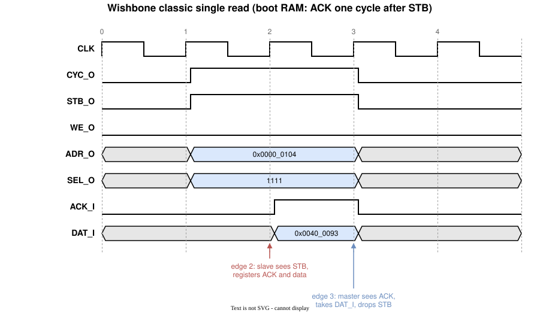
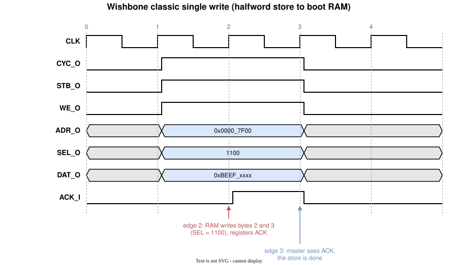

# 1. Wishbone basics

## The idea: master, slave, handshake

Every bus transfer has two sides:

- the **master** starts it. It decides the address, whether it is a read or a
  write, and (for a write) the data;
- the **slave** finishes it. It performs the read or write and tells the
  master "done".

Because the slave decides when it is done, a fast block RAM and a slow SDRAM
can sit on the same bus: the master simply waits until the slave answers. This
waiting is the whole point of a **handshake**. The master raises a *request*,
the slave raises an *acknowledge*, and only then does the transfer count.

Wishbone is a published, royalty-free specification (Wishbone B4, OpenCores)
that names these wires and fixes the rules. Beresheet uses the **classic
single read/write cycle**: one request, one answer, no bursts, no pipelining.
That is the slowest Wishbone mode and by far the easiest to get right, which is
the right trade for a teaching SoC.

## The signals

The table lists the signals as seen from the master. A slave has the same set
with the directions reversed (`_I` and `_O` swap). In the RTL they are written
in lower case with a `wb_` prefix, for example `wb_stb_o`.

| Signal | Width | Driven by | Meaning |
|--------|-------|-----------|---------|
| `CLK_I` | 1 | system | Every signal is sampled on the rising edge |
| `RST_I` | 1 | system | Reset; here the SoC-wide `rst` |
| `CYC_O` | 1 | master | "A bus cycle is in progress." Claims the bus; the arbiter grants on it |
| `STB_O` | 1 | master | "This transfer is valid now." The slave acts only while STB is high |
| `WE_O` | 1 | master | 1 = write, 0 = read |
| `ADR_O` | 32 | master | Byte address. Bits 1:0 are always zero on this bus |
| `SEL_O` | 4 | master | Byte lanes: `SEL[i]` = 1 means byte `i` of the word takes part |
| `DAT_O` | 32 | master | Write data |
| `DAT_I` | 32 | slave | Read data, valid in the cycle where ACK is high |
| `ACK_I` | 1 | slave | Normal end of the transfer |
| `ERR_I` | 1 | slave | Abnormal end of the transfer (here: nothing lives at that address) |
| `LOCK_O` | 1 | master | "Do not give the bus to anyone else between my transfers" (chapter 3) |

The specification also defines `RTY_I` (retry) and tag signals. Beresheet does
not use them.

Three rules make the handshake work:

1. **Hold steady.** From the cycle STB goes high until the cycle ACK (or ERR) is
   seen, the master must not change ADR, DAT_O, SEL or WE.
2. **One answer per strobe.** The slave must answer every STB with exactly one
   ACK or ERR. A slave that never answers hangs the master forever, which is why
   the interconnect contains an error slave (chapter 4).
3. **Everything is sampled on the clock edge.** A signal "is seen" at the rising
   edge at the end of the cycle in which it is high.

### Byte lanes

The data bus is 32 bits wide, but RISC-V also has byte (`lb`, `sb`) and
halfword (`lh`, `sh`) accesses. Wishbone handles them with `SEL`: the address
names the 32-bit word, and `SEL` says which bytes of it are meant.

| Access at byte address | `SEL` | Data lanes used |
|------------------------|-------|-----------------|
| word at `...0` | `1111` | `DAT[31:0]` |
| halfword at `...0` | `0011` | `DAT[15:0]` |
| halfword at `...2` | `1100` | `DAT[31:16]` |
| byte at `...0`, `...1`, `...2`, `...3` | `0001`, `0010`, `0100`, `1000` | `DAT[7:0]`, `[15:8]`, `[23:16]`, `[31:24]` |

The core does the shifting itself: for a store it moves the data into the
right lane, and for a load it shifts the returned word back down
(`RTL/core/mem_wb.v`). Loads carry a narrow `SEL` too, which matters for the
UART: it uses the lane to tell its byte-wide registers apart
([UART chapter](../peripherals/03-uart16550.md)).

## A single read, cycle by cycle

The figure shows a read from the boot RAM, the fastest slave on the bus. The
numbers on top count rising clock edges.



- **Cycle 1.** The master raises CYC and STB, puts the word address on ADR, and
  sets SEL = `1111` with WE = 0.
- **Edge 2.** The boot RAM sees STB. In the same edge it registers `ACK = 1` and
  registers the addressed word onto `DAT_I`.
- **Cycle 2.** ACK and the data are visible to the master.
- **Edge 3.** The master sees ACK, captures DAT_I, and is free to drop STB and
  CYC (or start the next transfer).

So the boot RAM answers in two cycles: one to present the request, one to
present the answer. A slower slave simply keeps ACK low for longer; the master
keeps waiting with all its signals frozen. Those extra cycles are called
**wait states**.

## A single write, cycle by cycle



This is `sh` of `0xBEEF` to address `0x0000_7F02`. The bus address is the
word, `0x0000_7F00`; `SEL = 1100` selects the upper two bytes; the data sits
in `DAT_O[31:16]`. At edge 2 the RAM writes exactly those two bytes and raises
ACK. At edge 3 the master sees ACK and the store is complete. No
read-modify-write is needed, because the block RAM has a write enable per byte.

## How our slaves answer: the one-line idiom

Almost every slave in the SoC (boot RAM, CLINT, PLIC, LED PWM) answers with the
same two lines:

```verilog
wire sel = wb_stb_i & wb_cyc_i & ~wb_ack_o;   // a new request, not one we already answered
always @(posedge clk) wb_ack_o <= sel;         // answer one cycle later
```

The `~wb_ack_o` term is the subtle part. In the cycle where ACK is high, the
master has not yet seen it (it only samples at the end of that cycle), so STB
is still high. Without the guard the slave would treat that still-high STB as a
second request and do the access twice. A write to a FIFO would push twice; a
read of the PLIC claim register would claim twice. With the guard, the slave
answers each strobe exactly once even when a master keeps STB high
back-to-back, as the instruction cache does while filling a line.

The UART and the SD card controller are third-party designs with their own
timing, and the SDRAM needs many cycles. They follow the same rules, just with
more wait states; their chapters show how.

## Where this is in the RTL

| What | File | Key signals |
|------|------|-------------|
| Bus widths, memory map | `RTL/bus/wb_defines.vh` | `WB_DATA_WIDTH`, `WB_ADDR_WIDTH`, `WB_SEL_WIDTH`, `REGION_*` |
| The read/write timing shown above | `RTL/bus/wb_ram.v` | `sel`, `wb_ack_o`, `wb_dat_o` |
| Byte-lane shifting in the core | `RTL/core/mem_wb.v` | `dmem_wstrb`, `dmem_wdata`, `rdata_shifted_*` |
| Same ACK idiom in the devices | `RTL/peripherals/clint/clint_wb.v`, `plic/plic_wb.v`, `gpio/led_pwm_wb.v` | `sel`, `wb_ack_o` |
