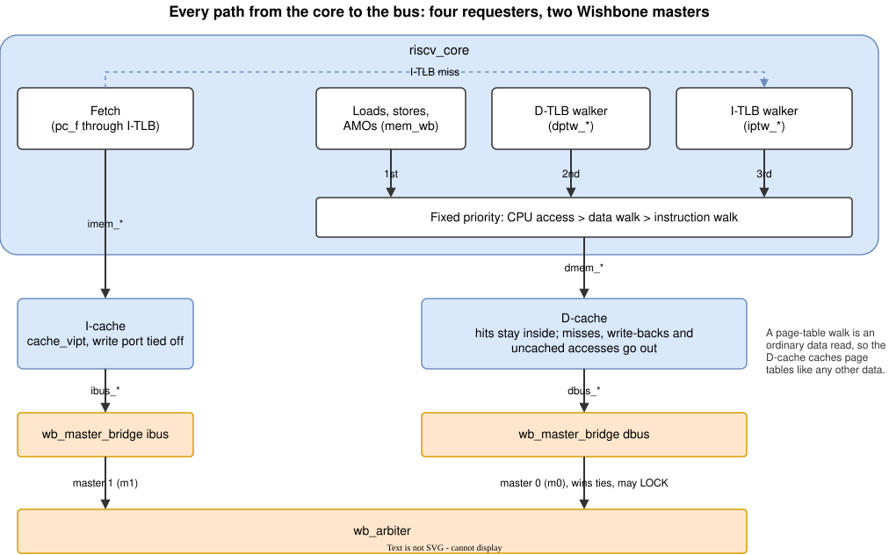
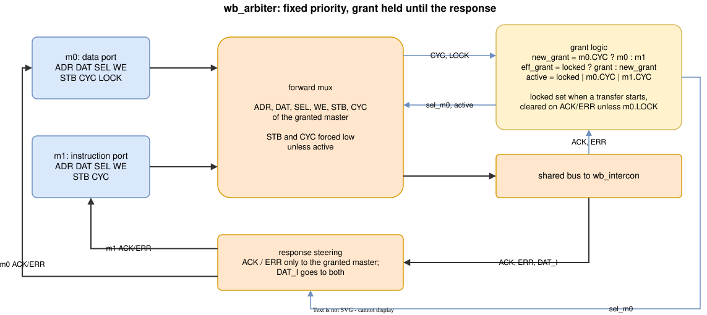
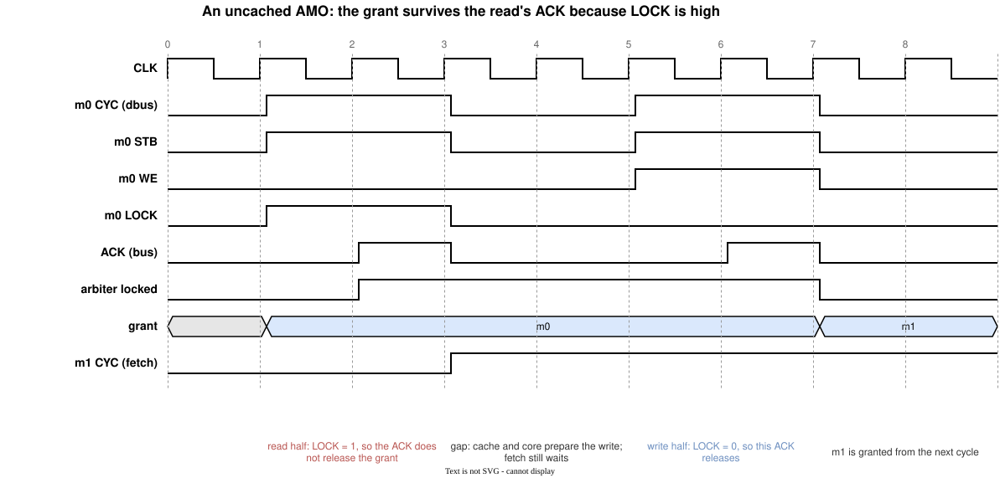

# 3. Masters, arbitration and bus lock

## The idea: one bus, several voices

A shared bus can carry one transfer at a time. When two masters want it in the
same cycle, something has to choose, and the loser has to wait without losing
its request. That something is the **arbiter**.

Before looking at the arbiter, it helps to know exactly who can ask for the
bus. In Beresheet that is less obvious than "the CPU".

## Who masters the bus

Inside the core there are **four requesters**:

| Requester | What it reads or writes |
|-----------|-------------------------|
| Fetch | The next instruction, at the physical address from the I-TLB |
| Load/store unit (`mem_wb`) | Loads, stores, LR/SC and AMOs |
| D-TLB walker | Page-table entries, when a load or store misses the D-TLB |
| I-TLB walker | Page-table entries, when a fetch misses the I-TLB |

Fetch has the `imem` port to itself. The other three share the `dmem` port
through a fixed-priority multiplexer in `riscv_core.v`:

1. the CPU's own access first;
2. then the data walk;
3. then the instruction walk.

A page-table walk is an ordinary read of physical memory, so it goes through
the same port and the same D-cache as any load. Page tables are cached exactly
like other data.

Each port then goes through its cache, and only what the cache cannot answer
reaches the bus:

| Cache | What goes out on the bus |
|-------|--------------------------|
| I-cache (4 KB, 4-way, 64-byte lines) | Line fills: 16 single-word reads, one after another, with STB held high throughout |
| D-cache (4 KB, 4-way, 64-byte lines, write-back) | Line fills as above; write-backs of a dirty victim line (16 single-word writes); and every **uncached** access as one single transfer |

An access is cached only if its physical address lies in one of two windows:
the SDRAM (`0x8000_0000`, 8 MB) and the boot RAM (`0x0000_0000`, 32 KB).
Everything else is a device and bypasses the cache, because reading a device
twice is not the same as reading it once: a cached UART would lose
characters, a cached CLINT would return a frozen `mtime`. The D-cache
registers an uncached request before putting it on the bus and registers the
answer before returning it, which costs two cycles per device access and keeps
the cache's decode logic off the SoC's longest timing path.

So the bus has exactly **two Wishbone masters**: `dbus` (from the D-cache) and
`ibus` (from the I-cache). The arbiter calls them m0 and m1.

## The arbiter

The arbiter has three jobs.

**1. Choose.** If the data port (m0) has CYC high, it wins; otherwise the
instruction port (m1) gets the bus. The data port wins because a data access is
already blocking an instruction that is about to retire, while a waiting fetch
only delays work that has not started.

Strict priority could, in principle, starve the loser. It cannot here: a data
access exists only because an instruction was fetched, so data requests are
finite and the instruction port always gets the bus back.

**2. Hold the grant for the whole transfer.** Wishbone requires the master's
signals to stay steady from STB to ACK, so the grant must not move in the
middle. The arbiter keeps a register `locked`:

- in the first cycle of a transfer the grant is computed combinationally
  (`eff_grant = new_grant`), so the transfer starts without losing a cycle;
- at that clock edge `grant` and `locked` are latched, and from then on the
  latched grant is used;
- `locked` clears when the slave answers (ACK or ERR).

Release happens on the **answer**, not on CYC falling. A cache filling a line
keeps CYC and STB high for all 16 words; if the arbiter waited for CYC to drop,
the data port could not get in until the whole line had arrived. Releasing on
each ACK lets the data port slip in between two words of an instruction fill.

**3. Route the answer.** ACK and ERR go only to the granted master, so the other
one keeps waiting instead of mistaking someone else's ACK for its own. Read
data goes to both; it is only taken by the master that sees ACK.

STB and CYC reach the bus only when `active` is true, that is, when a grant
exists. An earlier version let STB through before the grant had settled, so a
transfer could start under the previous grant and its ACK would then be routed
to the new one: the data port received the instruction port's data. Gating
with `active` and choosing the first grant combinationally removed that bug.

**Cost of re-arbitration.** None. Because the new grant is chosen
combinationally in the cycle after an ACK, a master that keeps STB high starts
its next transfer immediately. Against the boot RAM, which answers in two
cycles, a line fill runs at one word every two cycles, and a data request that
arrives in the middle is served between two of those words.

## Bus lock for atomics

An RV32A atomic memory operation such as `amoadd.w` is a read followed by a
write of the same word. Between the two, no other master may write that word,
or the update would be lost. Wishbone provides `LOCK_O` for this: while a
master holds LOCK, "the interconnect does not grant the bus to any other master
until the current master negates LOCK or CYC" (Wishbone B4, 2.2.3).

Beresheet implements it end to end:

1. `mem_wb.v` drives `dmem_lock` high during the **read** half of an AMO and low
   during the write half;
2. the D-cache passes it on as `mem_lock`, but only for an uncached transfer
   that is on the bus;
3. the bridge turns it into `LOCK_O` (and keeps CYC high with it);
4. the arbiter does not release on an ACK while the granted master is m0 and
   LOCK is high. The next ACK, from the write half with LOCK low, releases it.

Two details are worth stating plainly.

- **Lock is dropped for the last transfer, not after it.** The arbiter releases
  on an ACK only when LOCK is low. If LOCK stayed high through the write, the
  grant would never come back and the instruction port could never fetch
  again. That deadlock happened once, which is why `mem_wb.v` asserts the lock
  only in the read phase.
- **In practice the lock rarely reaches the bus.** With the D-cache built, an
  atomic on SDRAM or boot RAM is done entirely inside the cache and never
  touches the bus; only an atomic on an uncached address puts LOCK on the wire.
  The CPU is also the only master that writes memory (the I-cache only reads).
  The lock therefore changes nothing today. It is there so that atomics stay
  correct the day a DMA-capable device is added as a third master.

Also note the gap in the figure: with the D-cache present, CYC falls between
the read and the write halves (cycles 3 and 4) while the cache and the core
prepare the write. The arbiter still holds the grant, because it only releases
on a lock-free ACK, so the instruction port keeps waiting.

## Where this is in the RTL

| What | File | Key signals |
|------|------|-------------|
| The dmem priority mux | `RTL/core/riscv_core.v` | `cpu_dmem_req`, `dptw_grant`, `iptw_grant`, `dmem_*` |
| Caches and cacheable windows | `RTL/core/cache.v`, instances in `RTL/soc/soc_wb.v` | `CACHEABLE_BASE/SIZE`, `CACHEABLE2_BASE/SIZE`, `S_FILL`, `S_EVICT_XFER`, `S_UNC_XFER`, `mem_lock` |
| Lock in the core | `RTL/core/mem_wb.v` | `amo_read_phase`, `dmem_lock` |
| The arbiter | `RTL/bus/wb_arbiter.v` | `new_grant`, `eff_grant`, `grant`, `locked`, `active`, `sel_m0`, `m0_lock_i` |
| Instance | `RTL/soc/soc_wb.v` | `arb`, `m0_*`, `m1_*`, `b_*` |
