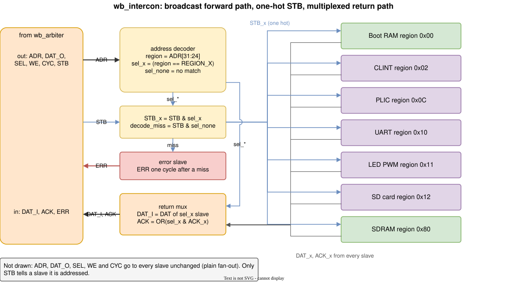

# 4. The interconnect

## The idea: shout the question, listen to one answer

After the arbiter there is one master's worth of signals. Seven slaves could
answer it. The interconnect connects the two sides, and it is simpler than it
sounds:

- **Forward direction (master to slaves): broadcast.** ADR, DAT_O, SEL, WE and
  CYC go to every slave unchanged. That is plain fan-out: no multiplexer.
- **One wire per slave says "this is for you": STB.** A decoder looks at the
  address and raises the STB of exactly one slave, or of none.
- **Return direction (slaves to master): multiplex.** Every slave drives its own
  DAT and ACK; the interconnect passes back only those of the selected slave.



## Address decoding

Each region is selected by the top byte of the address:

```verilog
wire [7:0] region = m_adr_i[31:24];           // `REGION_SEL(a)
wire sel_uart = (region == `REGION_UART);     // 8'h10
...
assign uart_stb_o = m_stb_i & sel_uart;
```

One 8-bit comparison per slave. Each region is therefore 16 MB of address
space, far more than any device needs. A slave decodes only the low address
bits it cares about, so its registers repeat (alias) through the rest of its
region. For example, the UART uses `ADR[4:0]`, so `0x1000_0005` and
`0x1000_0025` reach the same register. Software should use only the documented
addresses.

The full list of regions is in the [memory map chapter](05-memory-map.md).

## The return multiplexer

```verilog
assign m_dat_o = sel_boot  ? boot_dat_i  :
                 sel_clint ? clint_dat_i :
                 ...                     : 32'd0;
assign m_ack_o = (sel_boot & boot_ack_i) | (sel_clint & clint_ack_i) | ...;
```

The select signals come straight from the address, not from STB. That is fine:
the master holds the address steady until it sees ACK, so the mux stays on the
right slave for the whole transfer. Masking each ACK with its `sel_*` means a
slave that is still finishing an old answer cannot acknowledge someone else's
transfer.

## The error slave

Wishbone requires an answer to every STB. An address that matches no region
would never get one, and the master would wait forever with no clue why. So
the interconnect includes a tiny responder:

```verilog
assign decode_miss = m_stb_i & sel_none;
always @(posedge clk) err_ack <= decode_miss & ~err_ack;   // one cycle, then release
assign m_err_o = err_ack;
```

One cycle after a strobe to an unmapped address, ERR goes high for one cycle.
The master bridge turns that into a zero read and a sticky `bus_error` flag
([chapter 2](02-master-bridge.md)). The SoC also exports `decode_miss` so a
testbench can see the moment it happens.

The reserved regions for future peripherals (Ethernet `0x13`, HDMI `0x14`, USB
`0x15`, PCIe `0x16`, see `wb_defines.vh`) are not decoded yet, so they too are
answered by the error slave.

## Adding a device

Because the forward path is broadcast, a new slave costs two lines here:

1. a `sel_x` compare and an `x_stb_o = m_stb_i & sel_x` in the decoder (and
   `sel_x` added to `sel_none`);
2. one more term in the DAT and ACK return mux.

Plus the slave itself, its region constant in `wb_defines.vh`, and its
instance in `soc_wb.v`. The LED PWM block (`RTL/peripherals/gpio/led_pwm_wb.v`)
is written as the minimal example of such a device; see the
[LED chapter](../peripherals/04-led-pwm.md).

## Where this is in the RTL

| What | File | Key signals |
|------|------|-------------|
| Decoder, return mux, error slave | `RTL/bus/wb_intercon.v` | `region`, `sel_*`, `sel_none`, `*_stb_o`, `m_dat_o`, `m_ack_o`, `err_ack`, `decode_miss` |
| Region constants | `RTL/bus/wb_defines.vh` | `REGION_SEL`, `REGION_*` |
| Instance and wiring | `RTL/soc/soc_wb.v` | `icon`, `s_adr`, `s_dat_w`, `s_sel`, `s_we`, `s_cyc`, `*_stb`, `*_ack`, `*_dat` |
