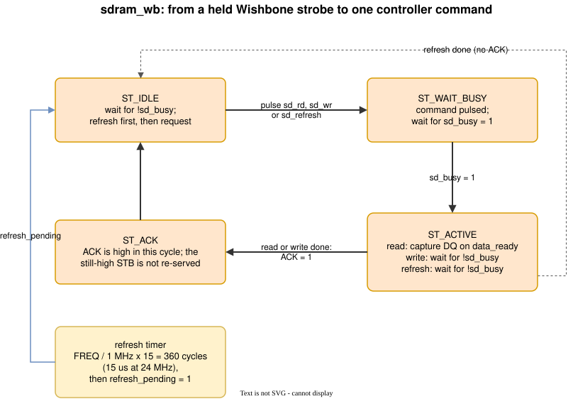

# 6. Memories: boot RAM and SDRAM

The SoC has two memories of very different character:

| | Boot RAM | SDRAM |
|--|----------|-------|
| Technology | FPGA block RAM (static) | Dynamic RAM inside the GW2AR-18 package |
| Size | 32 KB | 8 MB |
| Address | `0x0000_0000` | `0x8000_0000` |
| STB to ACK | 2 cycles | about 7 to 8 cycles |
| Contents at power-up | The BIOS, loaded with the bitstream | Undefined |
| Needs refresh | no | yes, every 15 us |

## Boot RAM (`wb_ram`)

### The idea

When the FPGA is configured, block RAM can be pre-loaded with any contents.
Beresheet uses that to hold the BIOS: at reset the core starts fetching at
address 0, and the program is already there. The BIOS also keeps its stack and
data in the same 32 KB, so it does not depend on the SDRAM working, which
matters because one of its jobs is to test the SDRAM.

### The RTL

`wb_ram` is one array of 32-bit words with a write enable per byte:

```verilog
reg [31:0] mem [0:WORDS-1];                    // 8192 words for 32 KB
wire [IDX_WIDTH-1:0] idx = wb_adr_i[IDX_WIDTH+1:2];
wire sel = wb_stb_i & wb_cyc_i & ~wb_ack_o;

always @(posedge clk) begin
    wb_ack_o <= sel;
    if (sel) begin
        if (wb_we_i) begin
            if (wb_sel_i[0]) mem[idx][7:0] <= wb_dat_i[7:0];
            ...                                   // one line per byte lane
        end
        wb_dat_o <= mem[idx];                     // read-first
    end
end
```

- **Single-cycle answer.** ACK and read data are registered on the same edge,
  so they appear together one cycle after STB (the timing diagrams in
  [chapter 1](01-wishbone-basics.md) are exactly this module).
- **Byte writes for free.** `SEL` drives the byte write enables directly, so
  `sb` and `sh` need no read-modify-write. This shape (one wide array, sliced
  writes) is what Gowin, Vivado and Verilator all recognise as a
  byte-enabled block RAM.
- **Initial contents.** `INIT_FILE` is a text file with one 32-bit hex word per
  line, loaded with `$readmemh`. The build produces it from the BIOS binary with
  `scripts/translate_bin_to_vmem.py`, padded to the full 8192 words, because Gowin
  will not unroll a zero-fill loop that long.
- **Read-first.** During a write the module still registers the *old* word onto
  `wb_dat_o`. The master ignores it; the point is that this matches what block
  RAM hardware does, so the memory is inferred as block RAM rather than built
  from flip-flops.

The same module serves as the SDRAM stand-in in some simulations.

## SDRAM (`sdram_wb` and `sdram_core`)

### The idea: memory that forgets

SDRAM stores each bit as charge on a tiny capacitor. The charge leaks away, so
every row must be read and rewritten (**refreshed**) regularly: this part
needs 4096 refreshes every 64 ms, one every 15.6 us. SDRAM is also organised
in banks, rows and columns. Before a column can be read, its row must be
opened (**activated**); afterwards it must be closed (**precharged**). A
controller hides all of that behind a simple "read this word" interface.

### Two layers

```
Wishbone  ->  sdram_wb (adapter + refresh timer)  ->  sdram_core (command sequencer)  ->  SDRAM pins
```

**`sdram_core`** is derived from nand2mario's controller for the Tang Nano 20K
(used in the NESTang project). It takes a one-cycle `rd`, `wr` or `refresh`
pulse and returns `busy` and, for reads, `data_ready`. Every access is a
complete activate, read-or-write with auto-precharge sequence; there are no
bursts and no open-row tricks. With the default timing parameters (`CAS = 2`,
`T_RCD = 1`, `T_RP = 1`, `T_WR = 2`, `T_RC = 4` clocks) the core spends four to
five clocks per access. The byte address maps onto the 64 Mbit part
(2 K rows x 256 columns x 4 banks x 32 bits) as:

| Address bits | Use |
|--------------|-----|
| `[1:0]` | byte in word (handled by DQM) |
| `[9:2]` | column (256) |
| `[20:10]` | row (2048) |
| `[22:21]` | bank (4) |

At power-up the controller waits 200 us (counted from `FREQ`), then precharges
all banks, issues two auto-refreshes and programs the mode register (burst
length 1, CAS latency 2). It keeps `busy` high until that is done.

The SDRAM chip is clocked by `clk_sdram`, a phase-shifted copy of the system
clock from the PLL's second output. The shift places the SDRAM's sampling point
in the middle of the controller's data window.

**Masked writes.** The original controller wrote a single byte per access. The
Beresheet version takes a 32-bit `din32` and a 4-bit `wmask`, and drives the
SDRAM's byte masks as `DQM = ~wmask`. A word store is therefore one
transaction instead of four, and byte and halfword stores still touch only
their own lanes. Wishbone's `SEL` goes straight to `wmask`.

**`sdram_wb`** turns a Wishbone transfer into one controller command and keeps
the SDRAM refreshed.



- A free-running timer counts `FREQ / 1 MHz x 15` cycles (360 at 24 MHz, i.e.
  every 15 us) and then sets `refresh_pending`.
- In `ST_IDLE`, when the controller is not busy, a pending refresh goes
  **first**; only then is a waiting Wishbone request served. A bus master can
  always be made to wait by withholding ACK; a skipped refresh would silently
  corrupt memory. Refresh costs about 1% of the bandwidth.
- The command is a one-cycle pulse. `busy` rises only in the *next* cycle, so
  the adapter first waits for `busy` to go high (`ST_WAIT_BUSY`) and only then
  for it to go low (`ST_ACTIVE`). Waiting directly for `!busy` would see the
  old idle state and finish at once.
- For a read, the data on the SDRAM data pins is valid only in the cycle
  `data_ready` is high, so it is captured into `wb_dat_o` exactly then, together
  with raising ACK.
- `ST_ACK` is the cycle in which ACK is high. The master has not yet dropped its
  STB in that cycle, so the adapter must not start another access; it returns to
  `ST_IDLE` one cycle later.

Counting through the two state machines, a read is acknowledged about seven
cycles after its STB and a write about eight, plus the wait for any refresh in
progress. This is why the caches matter: a cache hit costs two cycles and
never touches the SDRAM.

## Where this is in the RTL

| What | File | Key signals |
|------|------|-------------|
| Boot RAM | `RTL/bus/wb_ram.v` | `mem`, `idx`, `sel`, `wb_ack_o`, `INIT_FILE` |
| Boot RAM instance | `RTL/soc/soc_wb.v` | `bootram`, `BOOT_INIT` |
| SDRAM adapter and refresh | `RTL/peripherals/sdram/sdram_wb.v` | `state`, `refresh_timer`, `refresh_pending`, `sd_rd`, `sd_wr`, `sd_refresh`, `sd_busy`, `sd_data_ready` |
| SDRAM controller | `RTL/peripherals/sdram/sdram_core.v` | `state`, `cycle`, `busy`, `data_ready`, `SDRAM_DQM`, `wmask_buf`, `cfg_now` |
| Phase-shifted SDRAM clock | `RTL/fpga/tangnano20k/gowin_rpll.v`, `top_tang_nano_20k.v` | `clkoutp`, `clk_sdram` |
