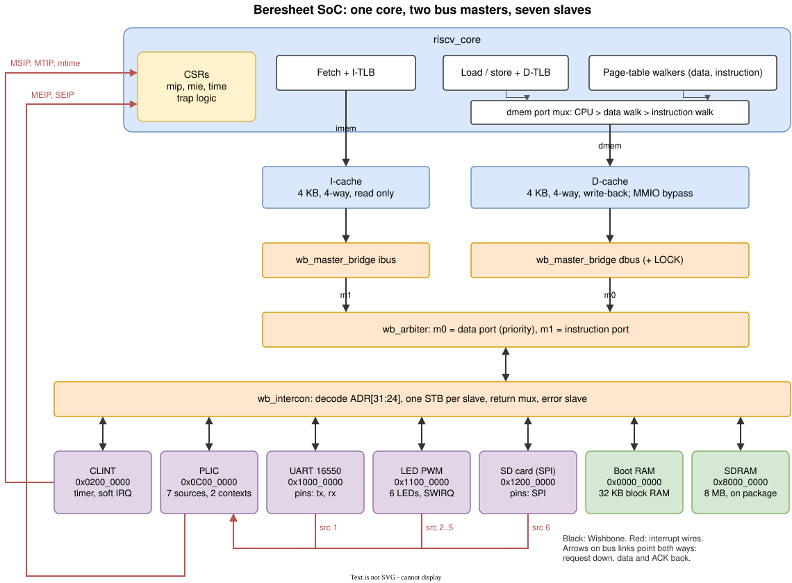

# The bus

A CPU on its own can only compute. Everything it reads or writes outside its
registers (the program, the stack, the UART, the timer) is reached through
the **bus**: a set of shared wires plus a small protocol that says who is
talking, to whom, and when the exchange is finished.

Beresheet uses **Wishbone B4**, an open bus standard from OpenCores, in its
simplest *classic* form. This part of the book follows one memory access from
the core's pins to the device that answers it, and back.

Read the figure from top to bottom:

1. The core has two memory ports: one for instruction fetch (`imem`) and one
   for loads, stores and page-table walks (`dmem`).
2. Each port goes through a 4 KB cache. Hits never reach the bus.
3. A **master bridge** turns each cache's memory port into a Wishbone master.
4. The **arbiter** lets one master at a time use the shared bus. The data port
   wins a tie.
5. The **interconnect** looks at the address, picks one of seven **slaves**, and
   routes that slave's answer back.
6. Interrupts travel on separate wires (red): the UART, LED block and SD card
   signal the PLIC, and the PLIC and CLINT signal the core. The
   [peripherals part](../peripherals/README.md) covers those.

## Chapters

| # | Chapter | What you learn |
|---|---------|----------------|
| 1 | [Wishbone basics](01-wishbone-basics.md) | Master and slave, the signals, a single read and a single write, cycle by cycle |
| 2 | [From core port to Wishbone master](02-master-bridge.md) | How a request/ready port becomes CYC/STB/ACK, and what happens on a bus error |
| 3 | [Masters, arbitration and bus lock](03-masters-and-arbiter.md) | Who can start a bus cycle, how the arbiter picks one, and how LOCK keeps an atomic indivisible |
| 4 | [The interconnect](04-interconnect.md) | Address decoding, the return multiplexer and the error slave |
| 5 | [The memory map](05-memory-map.md) | Every region, its size, whether it is cached, and where software learns it |
| 6 | [Memories: boot RAM and SDRAM](06-memories.md) | The block-RAM slave that holds the BIOS, and the SDRAM controller with its refresh |

## Files at a glance

| File | Role |
|------|------|
| `RTL/bus/wb_defines.vh` | Bus widths, the memory map, PLIC source numbers |
| `RTL/bus/wb_master_bridge.v` | Core memory port to Wishbone master |
| `RTL/bus/wb_arbiter.v` | Two-master arbiter with LOCK |
| `RTL/bus/wb_intercon.v` | Address decoder, return mux, error slave |
| `RTL/bus/wb_ram.v` | Block-RAM slave (boot RAM) |
| `RTL/peripherals/sdram/sdram_wb.v`, `sdram_core.v` | SDRAM slave and controller |
| `RTL/soc/soc_wb.v` | The SoC top level that wires all of the above together |
