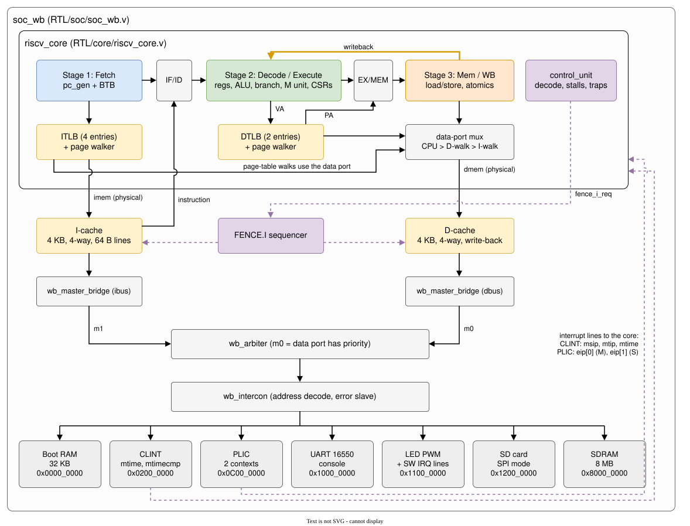

# 0. Overview

[Book index](../README.md) | Next: [1. Instructions and formats](01-isa-and-formats.md)

Beresheet is a 32-bit RISC-V processor with a three-stage in-order pipeline,
small instruction and data caches, and a memory-management unit good enough to
run Linux. This chapter names its parts and shows how they fit together. Every
later chapter zooms into one of the boxes in Figure 0.1.

## 0.1 What the ISA string means

The device tree describes the core to Linux as `rv32ima_zicsr_zicntr_zifencei`
with `mmu-type = "riscv,sv32"`. Read piece by piece:

| Part | Meaning | Where in this book |
|---|---|---|
| RV32 | 32-bit registers and addresses | [1](01-isa-and-formats.md) |
| I | The base integer instruction set: arithmetic, logic, shifts, loads, stores, branches, jumps | [1](01-isa-and-formats.md), [2](02-pipeline.md) |
| M | Integer multiply and divide | [3](03-m-extension.md) |
| A | Atomic memory operations: LR/SC and the AMOs | [4](04-a-extension.md) |
| Zicsr | The six instructions that read and write control and status registers (CSRs) | [5](05-privilege-and-traps.md) |
| Zicntr | The `cycle`, `time` and `instret` counters | [8](08-counters-and-timers.md) |
| Zifencei | `FENCE.I`, which makes stores visible to instruction fetch | [7](07-caches.md) |
| M/S/U | Three privilege modes: machine, supervisor, user | [5](05-privilege-and-traps.md) |
| Sv32 | Two-level page tables with 4 KiB pages and 4 MiB megapages | [6](06-virtual-memory.md) |

The same set is advertised in hardware by the read-only `misa` CSR, which reads
`0x4014_1101`: MXL = 1 (32-bit) in bits 31:30, and one bit for each of A (bit 0),
I (8), M (12), S (18) and U (20). OpenSBI and Linux both read it.

What is *not* in the list matters too: there is no C (compressed instructions),
no F or D (floating point), no PMP (physical memory protection), and there is
exactly one hart (hardware thread). [Chapter 10](10-limitations.md) collects these.

## 0.2 The block diagram

*Figure 0.1: The Beresheet SoC. The core (inner box) exposes one instruction
port and one data port. The caches, the Wishbone bus and the devices live in the
SoC around it.*

Reading the figure from the top:

- **The core** (`riscv_core`) is a three-stage pipeline: Fetch, Decode/Execute,
  and Memory/Writeback. A separate control unit decodes the instruction in stage
  2 and drives every stall, flush and trap. [Chapter 2](02-pipeline.md) is about
  this box.
- **Two MMUs** sit inside the core. The instruction TLB translates the program
  counter in stage 1; the data TLB translates load and store addresses in stage
  2. When a TLB misses, its page-table walker reads page-table entries through
  the core's *data* port, so both walkers share it with ordinary loads and
  stores. Physical addresses leave the core. [Chapter 6](06-virtual-memory.md).
- **Two caches** sit between the core's ports and the bus, in `soc_wb`: a 4 KB
  instruction cache and a 4 KB write-back data cache, both 4-way set
  associative with 64-byte lines. A small sequencer flushes both on `FENCE.I`.
  [Chapter 7](07-caches.md).
- **The bus.** Each cache's memory side drives a Wishbone master bridge; an
  arbiter picks one master per transfer (the data side wins a tie); an
  interconnect decodes the address and selects one device. Part II,
  [the bus](../bus/README.md), describes all three.
- **The devices**: 32 KB of boot RAM holding the BIOS, the CLINT (timer and
  software interrupts), the PLIC (external interrupts), a 16550-style UART, an
  LED/PWM block, an SPI-mode SD-card interface, and 8 MB of SDRAM. Part III,
  [the peripherals](../peripherals/README.md), describes them. Three of them
  talk back to the core directly: the CLINT drives `irq_soft`, `irq_timer` and
  the 64-bit `mtime` value; the PLIC drives `irq_ext` (machine mode) and
  `irq_ext_s` (supervisor mode).

## 0.3 Key numbers

| Property | Value |
|---|---|
| Pipeline | 3 stages, in order, single issue |
| Clock on the board | 24 MHz (27 MHz crystal through a PLL) |
| Register file | 32 x 32 bit, two read ports, one write port, in flip-flops, with write-through bypass |
| Branch prediction | 64-entry direct-mapped branch target buffer (BTB); a miss predicts "not taken" |
| Multiply | 2-stage pipelined 33 x 33 signed multiplier; 4 cycles in Decode/Execute |
| Divide | Restoring, one quotient bit per cycle; about 36 cycles in Decode/Execute |
| ITLB / DTLB | 4 / 2 entries, fully associative, ASID-tagged, round-robin replacement |
| I-cache / D-cache | 4 KB each, 4-way, 64-byte lines, pseudo-LRU; the D-cache is write-back and write-allocate |
| Cache hit latency | 2 cycles |
| Physical address space | 32 bits (Sv32 allows 34; the top two bits must be zero here) |
| Harts | 1 |
| Endianness | Little-endian only |
| Reset vector | `0x0000_0000`, machine mode |

## 0.4 How the core connects to the outside

The core's boundary is deliberately simple, so that the same core runs against a
behavioural memory in a testbench and against caches and a bus on the board.

| Port group | Signals | Protocol |
|---|---|---|
| Instruction fetch | `imem_addr`, `imem_req`, `imem_rdata`, `imem_ready` | Hold the request until `ready`; data is valid in that cycle |
| Data | `dmem_addr`, `dmem_wdata`, `dmem_wstrb`, `dmem_we`, `dmem_re`, `dmem_lock`, `dmem_rdata`, `dmem_ready` | Same; `dmem_wstrb` is a 4-bit byte-lane enable; `dmem_lock` holds the bus across an atomic read-modify-write |
| Cache maintenance | `fence_i_req`, `cache_flush_busy` | Two-edge handshake, see [7.7](07-caches.md#77-fencei-making-stores-visible-to-fetch) |
| Interrupts and time | `irq_soft`, `irq_timer`, `irq_ext`, `irq_ext_s`, `mtime[63:0]` | Level-sensitive wires into `mip`; `mtime` feeds the `time` CSR |
| Debug and trace | `retire_valid`, `retire_pc`, `retire_instruction`, `dbg_*`, `halted`, `trap_*` | Observation only; used by testbenches and LEDs |

Both memory ports carry *physical* addresses: translation happens inside the
core, before the request leaves it.

## 0.5 How to read the rest

Each chapter starts from the idea and the specification, then descends into
the microarchitecture, and ends with a table of files and signal names. For the
textbook background on single-cycle and pipelined RISC-V processors, read
Harris & Harris chapter 7 alongside chapter 2 here; Beresheet's pipeline is a
compressed variant of the five-stage pipeline described there.

## Where this is in the RTL

| What | File | Module |
|---|---|---|
| The core, its pipeline registers, the two MMU instances, the data-port mux | `RTL/core/riscv_core.v` | `riscv_core` |
| The SoC: caches, FENCE.I sequencer, bridges, arbiter, interconnect, devices | `RTL/soc/soc_wb.v` | `soc_wb` |
| Opcodes, ALU codes, immediate formats, base exception causes | `RTL/core/definitions.vh` | |
| CSR addresses, privilege encodings, `misa` value, delegation masks | `RTL/core/CSRdefinitions.vh` | |
| Memory map (region select, sizes) | `RTL/bus/wb_defines.vh` | |
| Board top level, PLL, power-on reset | `RTL/fpga/tangnano20k/top_tang_nano_20k.v`, `gowin_rpll.v` | |
| Device tree describing the machine to Linux | `firmware/dts/beresheet.dts` | |
