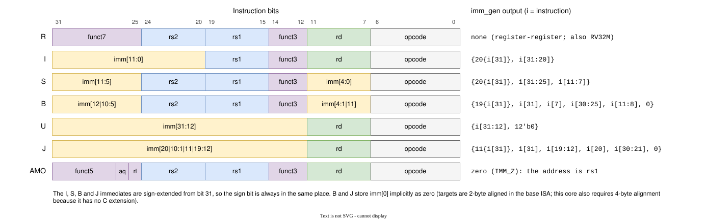

# 1. Instructions and formats

Previous: [0. Overview](00-overview.md) | [Book index](../README.md) | Next: [2. The three-stage pipeline](02-pipeline.md)

An instruction set is a contract between software and hardware. This chapter
lists the part of the RISC-V contract that Beresheet implements, shows how the
32 instruction bits are laid out, and explains how the control unit turns those
bits into the select signals that steer the datapath. The encodings themselves
are standard; Harris & Harris chapter 6 and appendix B introduce them gently,
and the unprivileged specification is the reference.

## 1.1 What is implemented

| Group | Instructions | Executed by |
|---|---|---|
| Integer register-immediate | `ADDI SLTI SLTIU XORI ORI ANDI SLLI SRLI SRAI` | ALU, stage 2 |
| Integer register-register | `ADD SUB SLL SLT SLTU XOR SRL SRA OR AND` | ALU, stage 2 |
| Upper immediates | `LUI AUIPC` | ALU (operand A forced to 0 or to the PC) |
| Jumps | `JAL JALR` | Target adder, stage 2; link value `PC + 4` |
| Branches | `BEQ BNE BLT BGE BLTU BGEU` | `branch_unit`, stage 2 |
| Loads and stores | `LB LH LW LBU LHU SB SH SW` | Address in stage 2, access in stage 3 |
| Memory ordering | `FENCE` (also `FENCE.TSO`, `PAUSE`) | Retires as a no-op, see below |
| Zifencei | `FENCE.I` | Flushes both caches, [chapter 7](07-caches.md) |
| M | `MUL MULH MULHSU MULHU DIV DIVU REM REMU` | `muldiv`, [chapter 3](03-m-extension.md) |
| A | `LR.W SC.W AMOSWAP.W AMOADD.W AMOXOR.W AMOAND.W AMOOR.W AMOMIN.W AMOMAX.W AMOMINU.W AMOMAXU.W` | Stage 3 sequencer, [chapter 4](04-a-extension.md) |
| Zicsr | `CSRRW CSRRS CSRRC CSRRWI CSRRSI CSRRCI` | CSR file, [chapter 5](05-privilege-and-traps.md) |
| Privileged | `ECALL EBREAK MRET SRET WFI SFENCE.VMA` | Control unit, [chapters 5](05-privilege-and-traps.md) and [6](06-virtual-memory.md) |

Two of these deserve a word now:

- **`FENCE` is a no-op.** A fence orders memory accesses as seen by other harts
  and devices. Beresheet has one hart, issues one memory access at a time, in
  program order, and has no store buffer, so every ordering a fence could ask
  for already holds. The `aq` and `rl` bits on atomics are ignored for the same
  reason. (Device accesses are never cached, see [7.3](07-caches.md#73-what-is-cached).)
- **`WFI` is a no-op.** The specification allows "wait for interrupt" to be
  implemented as "carry on", and there is no clock gating to save power with.
  `mstatus.TW` is still honoured: with TW set, `WFI` outside machine mode is
  an illegal instruction.

## 1.2 The six encodings

Every instruction is 32 bits. The opcode is always in bits 6:0, the destination
register `rd` in 11:7, the sources `rs1` and `rs2` in 19:15 and 24:20, and
`funct3` in 14:12. Only the immediate moves around.

*Figure 1.1: The base formats (R, I, S, B, U, J), the atomic variant of R, and
the immediate that `imm_gen` builds for each.*

The layout looks scrambled in S, B and J, but it is chosen for the hardware:
the sign bit is always bit 31, and most immediate bits stay in the same
instruction bit across formats, so the immediate generator is a handful of
wires and a 6-way multiplexer, not a shifter. B and J immediates have an
implicit 0 in bit 0, because branch and jump targets are at least 2-byte
aligned. Beresheet has no compressed instructions, so a target that is not
4-byte aligned raises an *instruction address misaligned* exception (cause 0)
on the jump or taken branch itself, before anything is fetched from there.

`imm_gen` supports one format the specification does not name: `IMM_Z`, a
constant zero. The atomics use the R-type layout, where bits 31:20 hold
`funct5`, `aq`, `rl` and `rs2` rather than an offset, but they still need the
address adder to compute `rs1 + 0`. Selecting zero is cheaper than adding a
special path.

## 1.3 Decoding

Decoding happens in one combinational block, the main decoder in
`control_unit`, which looks at the instruction sitting in stage 2. A `case` on
the opcode sets defaults that describe a no-op and then overrides only what the
instruction needs:

| Output | Meaning | Values |
|---|---|---|
| `alu_control` | ALU operation | `ADD SUB AND OR XOR SLL SRL SRA SLT SLTU` |
| `alu_src_a` | ALU operand A | `rs1`, `PC` (AUIPC), `0` (LUI) |
| `alu_src_b` | ALU operand B | `rs2`, immediate |
| `imm_src` | Immediate format | `IMM_I S B J U Z` |
| `wb_sel` | Write-back source | ALU result, loaded data, `PC + 4` |
| `reg_we`, `mem_re`, `mem_we` | Write `rd`, read memory, write memory | |
| `is_branch`, `is_jump`, `is_jalr` | Control transfer kind | |
| `is_muldiv`, `is_atomic`, `is_csr` | Route to the M unit, the atomic sequencer, the CSR file | |

Branch conditions are not computed in the ALU. A single "zero" flag cannot
express all six comparisons, so `branch_unit` compares `rs1` and `rs2` directly
(equal, signed less-than, unsigned less-than) next to the ALU.

At the end of the decoder, **every** output is forced to zero if the stage-2
slot is not valid (a bubble or a flushed instruction). That single rule is what
makes flushing safe: an instruction that has been cancelled cannot write a
register, touch memory, or report a misprediction.

### Illegal instructions

The decoder raises `illegal_instruction` for anything it does not recognise.
The checks are exact, not approximate:

- an unknown opcode;
- a reserved `funct3` for loads (`011`, `110`, `111`), stores (`011` and above),
  `JALR` (non-zero) and branches (`010`, `011`, flagged by `branch_unit`);
- a shift or register-register operation with a `funct7` other than the
  defined ones (`0000000`, `0100000` where it applies, `0000001` for M);
- an atomic with `funct3` other than `010` (word), an unknown `funct5`, or an
  `LR.W` whose `rs2` field is not zero;
- a `SYSTEM` instruction that is not one of ECALL, EBREAK, MRET, SRET, WFI,
  SFENCE.VMA or a CSR access, or that is not allowed in the current privilege
  mode (`MRET` outside M; `SRET` in U, or in S with `mstatus.TSR`; `SFENCE.VMA`
  in U, or in S with `mstatus.TVM`; `WFI` outside M with `mstatus.TW`);
- a CSR access that fails the access rules of [5.4](05-privilege-and-traps.md#54-csr-instructions-and-access-checks).

The trap that follows reports cause 2 and puts the instruction bits themselves
in `mtval` (or `stval`), so the handler does not have to fetch them again.

## 1.4 The ALU

`alu` is purely combinational: a `case` on `alu_control` over `ADD`, `SUB`,
`AND`, `OR`, `XOR`, the three shifts (using only `b[4:0]`, as RV32 requires),
and the two set-less-than variants. Everything that is not a plain ALU result,
such as the multiplier output or the old value of a CSR, joins the ALU result
on one bus in stage 2 (`alu_result`), so the pipeline register and the
write-back multiplexer need no extra inputs ([chapter 2](02-pipeline.md)).

## Where this is in the RTL

| What | File | Names |
|---|---|---|
| Opcode, `funct3`, `funct7`, `funct12` and `funct5` constants | `RTL/core/definitions.vh` | `OPC_*`, `F3_*`, `F7_*`, `F12_*`, `F5_*` |
| Main decoder and illegal-instruction detection | `RTL/core/control_unit.v` | `always @(*)` "Main decoder", `illegal_instruction` |
| Immediate generator | `RTL/core/imm_gen.v` | `imm_gen`, `imm_src` |
| ALU | `RTL/core/alu.v` | `alu`, `alu_control` |
| Branch comparator | `RTL/core/branch_unit.v` | `branch_unit`, `take_branch`, `illegal_funct3` |
| Operand multiplexers and result bus | `RTL/core/decode_exec.v` | `alu_a`, `alu_b`, `alu_result` |
| FENCE, FENCE.I, WFI handling | `RTL/core/control_unit.v` | `OPC_MISC` case, `is_fence_i`, `F12_WFI` |
