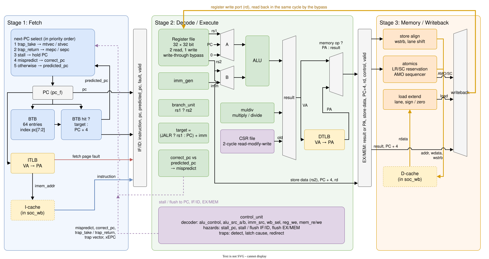
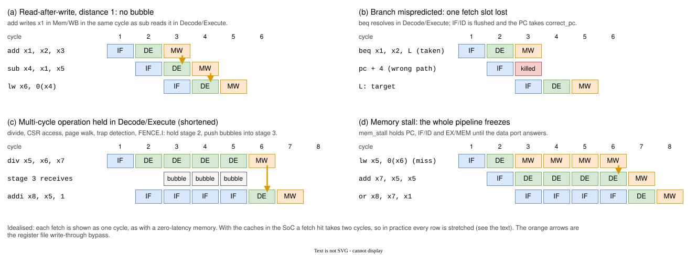

# 2. The three-stage pipeline

Previous: [1. Instructions and formats](01-isa-and-formats.md) | [Book index](../README.md) | Next: [3. Multiply and divide](03-m-extension.md)

Harris & Harris chapter 7 builds a five-stage RISC-V pipeline: Fetch, Decode,
Execute, Memory, Writeback, with a forwarding unit and a hazard unit. Beresheet
uses the same ideas in three stages. Decode and Execute are merged, and so are
Memory and Writeback. Fewer stages means fewer hazards to handle and a simpler
control unit; the price is more logic per stage, and therefore a lower clock
frequency (24 MHz on the board). This chapter walks through the stages, then
the hazards, then the rules that stall and flush them.

## 2.1 The stages at a glance

| Stage | Name in the RTL | What happens |
|---|---|---|
| 1 Fetch | `pc_gen`, ITLB | Hold the PC; look it up in the BTB to predict the next PC; translate it; request the instruction |
| 2 Decode/Execute | `decode_exec`, `control_unit`, DTLB | Decode; read registers; build the immediate; ALU; resolve branches and jumps; multiply/divide; CSR access; translate the data address; detect traps |
| 3 Memory/Writeback | `mem_wb` | Load or store (and atomics); align and extend loaded data; write the result to the register file |

Two pipeline registers separate them:

| Register | Contents | Module |
|---|---|---|
| IF/ID | `instruction`, `pc`, `predicted_pc`, `fault` (the fetch could not be translated), `valid` | `if_id_reg` |
| EX/MEM | `alu_result` (or the physical address for a memory access), `store_data`, `link_pc` (= PC + 4), `rd`, `reg_we`, `mem_re`, `mem_we`, `wb_sel`, `funct3`, `is_atomic`, `amo_funct5`, `valid`, plus `pc` and `instruction` for tracing | `ex_mem_reg` |

Each register has a **stall** input (keep the current contents) and a **flush**
input (load a bubble: a NOP with `valid = 0`). The `valid` bit is what makes a
flush safe. Without it, a flushed slot would still carry a PC and a predicted
PC, and stage 2 would compare them and report a misprediction that never
happened.



*Figure 2.1: The datapath. The orange line at the top is the register write
port, driven by stage 3 and read back by stage 2 in the same cycle. Dashed
purple lines are control.*

## 2.2 Stage 1: Fetch and branch prediction

### Choosing the next PC

`pc_gen` holds the program counter `pc_f` and chooses its next value with a
fixed priority:

| Priority | Condition | Next PC |
|---|---|---|
| 1 | reset | `0x0000_0000` |
| 2 | `trap_take` | `mtvec` or `stvec` (the trap handler) |
| 3 | `trap_return` (MRET/SRET) | `mepc` or `sepc` |
| 4 | `stall` | `pc_f` (hold) |
| 5 | `mispredict` | `correct_pc`, computed in stage 2 |
| 6 | otherwise | `predicted_pc` |

Traps outrank everything because a misprediction reported in the same cycle
belongs to an instruction that is about to be discarded anyway.

### The branch target buffer

Every cycle, the fetch PC is looked up in a **branch target buffer** (BTB):
64 entries, direct-mapped, indexed by `pc[7:2]`, each holding a valid bit, a
tag (`pc[31:8]`) and a 32-bit target. On a hit the BTB predicts "taken, to this
target"; on a miss it predicts "not taken", i.e. `PC + 4`. The prediction,
`predicted_pc`, goes to the next-PC selector and is also carried along in IF/ID
so that stage 2 can check it.

The BTB learns only from mistakes:

- predicted not taken, but the instruction jumped: write an entry with the real
  target (only if the target is 4-byte aligned, so a bad entry cannot
  manufacture misaligned fetches);
- predicted taken, but the instruction fell through: invalidate the entry.

There is no direction counter and no return-address stack. A loop branch is
predicted taken after its first taken execution and mispredicts once on loop
exit; a `JALR` return is predicted to go wherever it went last time. The BTB is
only a hint: a wrong entry costs a bubble and is then corrected by the same
mechanism, which is why its update logic deliberately ignores stalls and traps
(that kept the trap logic off the BTB write enables, which used to be the
longest timing path in the design).

### Translation and the request

The ITLB translates `pc_f` combinationally in the same cycle (or passes it
through unchanged when translation is off, [chapter 6](06-virtual-memory.md)).
The physical address goes out on `imem_addr` with `imem_req`. If the
translation faults, no request is made at all: IF/ID receives a **poisoned
slot** with `fault = 1`, which reaches stage 2 like an instruction and raises
an instruction page fault there ([5.5](05-privilege-and-traps.md#55-traps-exceptions-and-interrupts)).
Stage 1 is "stalled by fetch" (`fetch_stall`) while the ITLB is walking or the
instruction memory has not answered.

## 2.3 Stage 2: Decode and Execute

Almost all the work happens here, in parallel:

- the **register file** is read (two ports) and the **immediate** built;
- the **ALU** computes, with operand A chosen from `rs1`, the PC or zero and
  operand B from `rs2` or the immediate;
- the **branch unit** compares `rs1` and `rs2`, and a separate adder computes
  the target, `(JALR ? rs1 : PC) + imm` (with bit 0 cleared for JALR);
- the **M unit** and the **CSR file** start their multi-cycle operations
  ([chapter 3](03-m-extension.md), [chapter 5](05-privilege-and-traps.md));
- for loads and stores, the ALU result is the virtual address, which the
  **DTLB** translates;
- the **control unit** decodes, checks for every exception, and decides the
  stalls and flushes for the whole pipeline.

### Branch resolution

Stage 2 computes where the program *should* go next:

```
actual_taken = is_jump | (is_branch & branch_cond)
correct_pc   = actual_taken ? target : PC + 4
mispredict   = valid & (predicted_pc != correct_pc)
```

Comparing the predicted PC with the correct PC, rather than comparing
directions, covers every case at once: a branch predicted the wrong way, a jump
whose target changed, and a BTB entry that aliased onto an instruction that is
not a branch at all. On a misprediction the control unit flushes IF/ID (the
instruction fetched on the wrong path) and `pc_gen` loads `correct_pc`.

### One result bus

The ALU result, the multiplier/divider result and the old CSR value all leave
stage 2 on one 32-bit bus:

```
alu_result = is_csr ? csr_old : is_muldiv ? muldiv_result : alu_out
```

For a load, store or atomic, the value latched into EX/MEM is instead the
*physical* address from the DTLB. Bits 11:0 are not translated, so nothing
downstream needs both addresses.

## 2.4 Stage 3: Memory and Writeback

`mem_wb` turns the request into a word-aligned memory access: the address is
`{addr[31:2], 2'b00}`, the byte strobes `dmem_wstrb` select the lanes (`0001`
shifted for bytes, `0011` shifted for halfwords, `1111` for words) and store
data is shifted into its lane. The strobes are driven for reads too, because
on the bus they tell a device which bytes are wanted. Loaded data is shifted
down and sign- or zero-extended according to `funct3`. The atomic sequencer
also lives here ([chapter 4](04-a-extension.md)).

The write-back multiplexer chooses between the ALU result, the loaded value
and `PC + 4` (for `JAL`/`JALR`), with two extra cases for atomics: an AMO
writes the old memory value, and SC writes 0 for success or 1 for failure. The
register write port is driven **combinationally** from this multiplexer, and
`reg_we` is gated with `~mem_stall`, so a register is written exactly once, on
the cycle the instruction completes.

## 2.5 Data hazards: the write-through bypass

In a five-stage pipeline, an instruction can depend on results that are one,
two or three stages ahead, and a forwarding unit picks the newest one. In
Beresheet there is only *one* instruction ahead of stage 2: the one in stage 3.
Anything older has already written the register file.

So the only data hazard is "the instruction in stage 3 is writing a register
that the instruction in stage 2 reads", and the register file solves it by
itself. Each read port checks the write port:

```verilog
if      (raddr1 == 0)                rdata1 = 0;
else if (we && (waddr == raddr1))    rdata1 = wdata;   // write-through bypass
else                                 rdata1 = reg_file[raddr1];
```

Because stage 3 drives `we`, `waddr` and `wdata` combinationally, the value
being written this cycle is the value read this cycle. No forwarding
multiplexers, no hazard detection for read-after-write.

That includes **loads**. In a five-stage pipeline a load followed by a use
needs a one-cycle interlock, because the data arrives at the end of the Memory
stage. Here, the load's data comes back from the data cache in the cycle its
`ready` rises, flows through the load extender, the write-back multiplexer, the
bypass and into the ALU of the next instruction, all in that one cycle. Until
then `mem_stall` freezes the whole pipeline (see below), so the dependent
instruction simply waits in stage 2 with a stale operand that is never used.

There is a price, and it is timing rather than correctness. That chain (cache
read data, extend, write-back mux, bypass, ALU, DTLB compare) is the longest
combinational path in the design, and it is what limits the clock. The comments
in `riscv_core.v` record the measurements; a load-use interlock is the known
way to buy that time back.



*Figure 2.2: Pipeline timing. (a) a dependent instruction reads its operand
through the bypass; (b) a misprediction kills one fetched instruction;
(c) a multi-cycle operation holds stage 2 and sends bubbles into stage 3;
(d) a memory stall freezes everything.*

## 2.6 Stalls and flushes

Every stall and flush comes from one `always @(*)` block in `control_unit`.
There are only four *shapes* of intervention, and every situation uses one of
them:

| Shape | PC | IF/ID | EX/MEM | Meaning |
|---|---|---|---|---|
| Freeze | hold | hold | hold | Nothing moves; the access in stage 3 completes |
| Hold stage 2 | hold | hold | flush (bubble) | The instruction in stage 2 needs more cycles; the older one in stage 3 finishes exactly once |
| Redirect | new value | flush | flush | Take a trap or return from one |
| Kill fetch | new value | flush | advance | Misprediction: drop the wrongly fetched instruction |

The situations are checked in priority order; the first that applies wins:

| Priority | Condition | Shape | Cause |
|---|---|---|---|
| 1 | `halted` | Freeze | A trap was taken with `mtvec = 0` (debug aid, see [5.8](05-privilege-and-traps.md#58-the-null-vector-halt)) |
| 2 | `mem_stall` | Freeze | Stage 3's memory access (or atomic sequence) has not completed |
| 3 | `trap_take` or `trap_return` | Redirect | Enter a trap handler, or MRET/SRET |
| 4 | `trap_hold` | Hold stage 2 | A trap was detected and is waiting to be taken |
| 5 | `csr_stall` | Hold stage 2 | First cycle of a CSR read-modify-write |
| 6 | `muldiv_stall` | Hold stage 2 | Multiply or divide in progress |
| 7 | `xlate_stall` | Hold stage 2 | The DTLB is walking the page table for this load/store |
| 8 | `fence_stall` | Hold stage 2 | FENCE.I waiting for the caches |
| 9 | `fetch_stall` | Hold stage 2 | Instruction memory (or ITLB) not ready |
| 10 | `mispredict` | Kill fetch | Wrong next PC |

A few of these choices are worth understanding, because the obvious
alternative is wrong:

- **Why "hold stage 2, bubble stage 3" and not "freeze"?** The instruction in
  stage 3 is older and its work is independent; if it were frozen too, it would
  either complete twice or have to be told not to. Pushing a bubble behind it
  lets it finish exactly once, while the instruction in stage 2 waits.
- **Why does a fetch stall hold stage 2 instead of letting it drain?** A branch
  in stage 2 asserts `mispredict` only while it is there. If it moved on while
  the PC was blocked by the fetch, the redirect would be lost and execution
  would fall through the branch. Holding it keeps the request alive until the
  PC can act. (Draining would not help anyway: fetch and data share one bus.)
- **Why does `mem_stall` outrank a trap?** Flushing EX/MEM in the middle of a
  bus transfer would drop the Wishbone strobe mid-transaction and lose a store
  that belongs to an *older* instruction. A trap must wait until the bus is
  quiet; see `redirect_ok` in [5.5](05-privilege-and-traps.md#55-traps-exceptions-and-interrupts).

Several multi-cycle units also watch these signals. The M unit and the CSR
sequencer do not *start* while a higher-priority stall is active (the combined
signal is `pipeline_hold`): if the instruction ahead is a load still waiting on
the bus, the bypass is not yet active and `rs1`/`rs2` would be stale.

## 2.7 What this means for performance

The pipeline can complete one instruction per cycle only if every fetch and
every data access answers in the same cycle, which is how the core behaves
against an ideal memory in simulation. On the board, both caches take **two
cycles for a hit** ([chapter 7](07-caches.md)), so each fetch holds stage 2 for
at least one extra cycle and the best case is one instruction every two cycles.
A data-cache hit overlaps with the next fetch and costs nothing extra on top of
that. Misses, uncached device accesses, multiplies, divides, CSR accesses,
TLB misses and mispredictions all add to it. The BIOS measures and prints the
achieved cycles per instruction, from the `cycle` and `instret` counters.

## 2.8 Retirement

An instruction *retires* when it leaves stage 3 with `valid = 1`. The core
signals this with a one-cycle pulse, `retire_valid = valid_m & ~mem_stall`; the
`& ~mem_stall` matters, because a load held in stage 3 for ten cycles is still
one instruction. The same pulse increments `minstret`
([chapter 8](08-counters-and-timers.md)) and drives the testbench trace
(`retire_pc`, `retire_instruction`). An instruction that traps never reaches
stage 3, so it never retires, as the specification requires for ECALL and
EBREAK.

## Where this is in the RTL

| What | File | Names |
|---|---|---|
| PC register, next-PC priority, BTB | `RTL/core/pc_gen.v` | `pc_out` (= `pc_f`), `predicted_pc`, `btb_valid`, `btb_tag`, `btb_target`, `BTB_IDX_WIDTH` in `definitions.vh` |
| Fetch request, poisoned fetch, `fetch_stall` | `RTL/core/riscv_core.v` | `imem_req`, `itlb_fault`, `fetch_stall` |
| IF/ID register | `RTL/core/if_id_reg.v` | `valid_out`, `fault_out` |
| Stage 2 datapath, branch resolution, result bus | `RTL/core/decode_exec.v` | `correct_pc`, `mispredict`, `actual_taken`, `alu_result`, `link_pc` |
| Register file and bypass | `RTL/core/file_register.v` | `rdata1`, `rdata2`, "write-through bypass" |
| EX/MEM register, physical-address substitution | `RTL/core/ex_mem_reg.v`, `RTL/core/riscv_core.v` | `alu_result_in (dmem_op_d ? dtlb_paddr : alu_result_d)` |
| Stage 3: lanes, strobes, extension, write-back mux | `RTL/core/mem_wb.v` | `dmem_wstrb`, `load_extended`, `reg_wdata`, `mem_stall` |
| Stall and flush priority | `RTL/core/control_unit.v` | "Stall and flush generation", `pipeline_hold` |
| Retirement | `RTL/core/riscv_core.v` | `retire_valid` |
