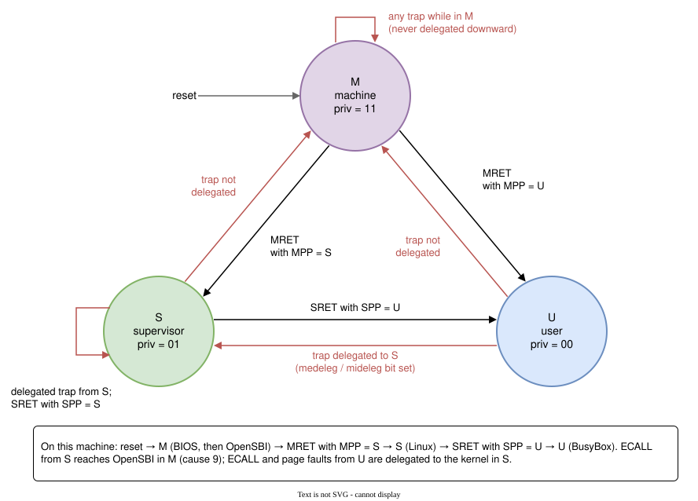
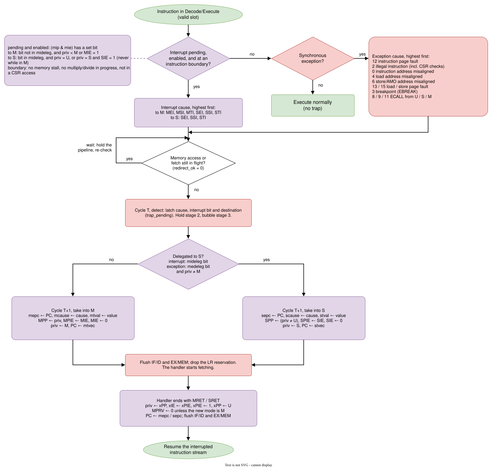

# 5. Privilege, CSRs and traps

Previous: [4. Atomics](04-a-extension.md) | [Book index](../README.md) | Next: [6. Virtual memory](06-virtual-memory.md)

A processor that runs an operating system needs a way to keep programs from
interfering with the kernel, and the kernel from interfering with the firmware.
RISC-V does it with **privilege modes**, **control and status registers**
(CSRs) that only some modes may touch, and **traps** that move the processor
into a more privileged mode in a controlled way. Harris & Harris introduce
exceptions and CSRs in chapter 6; this chapter shows how Beresheet implements
the full machine/supervisor/user arrangement that Linux expects.

## 5.1 Three modes

| Mode | Encoding (`priv`) | Who runs there on this machine |
|---|---|---|
| M, machine | `11` | The BIOS, then OpenSBI (the firmware that stays resident under Linux) |
| S, supervisor | `01` | The Linux kernel |
| U, user | `00` | BusyBox and every other process |

The current mode is a two-bit register, `priv`, inside the CSR file. It is
reset to M, and it changes in exactly two ways: a **trap** moves to M or S, and
an **xRET** instruction (`MRET`, `SRET`) moves to the mode saved when the trap
was taken.

*Figure 5.1: How the mode changes. Black arrows are returns, red arrows are
traps. A trap never moves to a less privileged mode.*

## 5.2 The CSR file

The CSR file (`CSR_unit`) holds the privileged state and answers one access at
a time. Each CSR has a 12-bit address whose top bits encode the access rules
(privileged specification, section 2.1): bits 11:10 = `11` means read-only, and
bits 9:8 give the lowest privilege that may access it. The control unit uses
those bits directly ([5.4](#54-csr-instructions-and-access-checks)).

### Implemented CSRs

| Address | Name | Notes |
|---|---|---|
| `0xC00`, `0xC80` | `cycle`, `cycleh` | Read-only views of `mcycle` |
| `0xC01`, `0xC81` | `time`, `timeh` | Read-only view of the CLINT's `mtime` ([chapter 8](08-counters-and-timers.md)) |
| `0xC02`, `0xC82` | `instret`, `instreth` | Read-only views of `minstret` |
| `0xB00`, `0xB80` | `mcycle`, `mcycleh` | 64-bit cycle counter, writable |
| `0xB02`, `0xB82` | `minstret`, `minstreth` | 64-bit retired-instruction counter, writable |
| `0xF11` to `0xF15` | `mvendorid`, `marchid`, `mimpid`, `mhartid`, `mconfigptr` | Read-only: 0, 0, 3, 0, 0 |
| `0x300` | `mstatus` | Fields below |
| `0x301` | `misa` | `0x4014_1101` (RV32 + A, I, M, S, U); writes ignored |
| `0x302`, `0x303` | `medeleg`, `mideleg` | Trap delegation, masked to the delegatable bits |
| `0x304`, `0x344` | `mie`, `mip` | Interrupt enable and pending, six sources |
| `0x305` | `mtvec` | Direct mode only: bits 1:0 always read 0 |
| `0x306` | `mcounteren` | Bits CY, TM, IR |
| `0x310` | `mstatush` | Read-only zero (little-endian only) |
| `0x340` to `0x343` | `mscratch`, `mepc`, `mcause`, `mtval` | `mepc` bits 1:0 always 0 |
| `0x100` | `sstatus` | Restricted view of `mstatus` |
| `0x104`, `0x144` | `sie`, `sip` | Restricted views of `mie`, `mip` (delegated bits only) |
| `0x105` | `stvec` | Direct mode only |
| `0x106` | `scounteren` | Bits CY, TM, IR |
| `0x140` to `0x143` | `sscratch`, `sepc`, `scause`, `stval` | `sepc` bits 1:0 always 0 |
| `0x180` | `satp` | Address translation root and mode ([chapter 6](06-virtual-memory.md)) |

Any other address is *not implemented* and raises an illegal instruction:
there are no PMP registers, no `mcountinhibit`, no hardware performance
counters (`mhpmcounter*`), no `menvcfg`/`senvcfg`, and no `stimecmp` (Sstc).

`sstatus`, `sie` and `sip` own no storage. They are windows onto `mstatus`,
`mie` and `mip`, as the specification requires; keeping one copy of each bit
makes it impossible for the two views to disagree.

### mstatus

| Bit(s) | Field | Meaning |
|---|---|---|
| 1, 3 | SIE, MIE | Global interrupt enable while running in S, in M |
| 5, 7 | SPIE, MPIE | Previous SIE / MIE, saved on trap entry |
| 8 | SPP | Previous mode for S traps (0 = U, 1 = S) |
| 12:11 | MPP | Previous mode for M traps; writing the reserved value `10` stores M |
| 17 | MPRV | Loads and stores in M use MPP's privilege for translation ([6.4](06-virtual-memory.md#64-when-translation-is-on)) |
| 18 | SUM | S may access U pages with loads and stores |
| 19 | MXR | Loads may read execute-only pages |
| 20 | TVM | Trap `satp` accesses and `SFENCE.VMA` in S |
| 21 | TW | Trap `WFI` outside M |
| 22 | TSR | Trap `SRET` in S |

The floating-point, vector and extension-state fields (FS, VS, XS, SD) and the
endianness bits read as zero. `sstatus` shows and writes only SIE, SPIE, SPP,
SUM and MXR (mask `0x000C_0122`).

## 5.3 Interrupt sources

| `mip` bit | Name | Driven by | Software-writable? |
|---|---|---|---|
| 11 | MEIP | PLIC context 0 (`irq_ext`) | No |
| 9 | SEIP | PLIC context 1 (`irq_ext_s`) OR a software bit | The software bit only |
| 7 | MTIP | CLINT, `mtime >= mtimecmp` (`irq_timer`) | No |
| 5 | STIP | Software only | Yes (from M) |
| 3 | MSIP | CLINT `msip` register (`irq_soft`) | No |
| 1 | SSIP | Software only | Yes |

There is no supervisor timer hardware (no Sstc). The supervisor timer is
delivered the classic way: the kernel asks OpenSBI to set the timer (an SBI
call, `ECALL` from S); OpenSBI programs `mtimecmp`; when the machine timer
fires, OpenSBI's M-mode handler sets `mip.STIP`, and since STI is delegated the
kernel then takes a supervisor timer interrupt.

One subtle detail is how `mip.SEIP` is read and written. Reading returns the OR
of the PLIC line and the software bit, as the specification says. But
`csrs`/`csrc` on `mip` must modify only the *software* bit: if the
read-modify-write used the ORed value, a timer tick that touched `mip.STIP`
while the PLIC happened to be asserting SEIP would copy that live value into the
software bit, where it would stay set after the device was serviced. That bug
existed and livelocked Linux in its PLIC handler; `rmw_seip_hw_only` is the
fix, and test `19_mip_seip_rmw` checks it.

## 5.4 CSR instructions and access checks

### The six instructions

`CSRRW`, `CSRRS` and `CSRRC` (and their immediate forms `CSRRWI`, `CSRRSI`,
`CSRRCI`, which take a 5-bit zero-extended value from the `rs1` field) all do
the same thing: read the old value into `rd`, then write a new value that is
the operand (`W`), the old value OR the operand (`S`, set bits), or the old
value AND NOT the operand (`C`, clear bits).

Two rules from the specification decide whether an access reads and whether it
writes, and the decoder implements both:

- `CSRRW`/`CSRRWI` with `rd = x0` does **not read** the CSR;
- `CSRRS`/`CSRRC` (and the immediate forms) with a zero mask (`rs1 = x0` or
  `uimm = 0`) does **not write** it.

The second rule is what makes `rdcycle` work: it is `csrrs rd, cycle, x0`,
which does not write, so it is legal on a read-only CSR.

### Two cycles, atomic

A CSR access takes two cycles in stage 2, run by a one-bit state machine in the
control unit (`STATE_RUNNING`, `STATE_CSR`):

1. **Capture** (`csr_capture`): read the CSR into the register `csr_old`. The
   pipeline holds stage 2 and bubbles stage 3.
2. **Commit** (`csr_commit`): compute the new value from `csr_old` and the
   operand, write it, and let the instruction leave stage 2 with `csr_old` as
   its result.

The capture is a register, not a wire, for two reasons. The value written back
must be derived from the same snapshot that `rd` receives; and the counters
change every cycle, so re-reading in the commit cycle would give a different
value. Because nothing else runs between the two cycles, the access is atomic.
The capture waits for any memory access in stage 3 to finish (a store to the
CLINT followed by a read of `mip` must see the effect of the store); the
commit waits until the instruction can actually leave, so a held instruction
does not write the CSR repeatedly.

### Access checks

Every check raises an *illegal instruction* (cause 2), decided in the control
unit next to every other exception:

| Check | Rule |
|---|---|
| Not implemented | The CSR file reports `exists = 0` |
| Read-only | Address bits 11:10 = `11` and the access writes |
| Privilege | Current `priv` lower than address bits 9:8 |
| `satp` under TVM | `satp` accessed from S with `mstatus.TVM = 1` |
| Counters | `cycle`/`time`/`instret` (and high halves): allowed in M; in S only if the `mcounteren` bit is set; in U only if both `mcounteren` and `scounteren` bits are set |

## 5.5 Traps: exceptions and interrupts

A **trap** is an unplanned transfer of control to a handler. It is an
*exception* when the instruction itself caused it (illegal, misaligned, page
fault, `ECALL`, `EBREAK`) and an *interrupt* when something outside did
(timer, software, external device). Both use the same machinery.

*Figure 5.2: Trap handling, from detection in stage 2 to the return.*

### Detection: everything is decided in stage 2

All exceptions are detected while the instruction is in stage 2, including
memory exceptions, because the data address is computed and translated there.
A load or store that would fault never reaches stage 3, so traps are
**precise**: every older instruction has completed, and the faulting one and
everything younger have had no effect.

When several exceptions apply to the same instruction, the cause with the
highest priority is reported:

| Priority | Cause | Code | `mtval` / `stval` |
|---|---|---|---|
| (higher than all) | Any enabled interrupt | 1, 3, 5, 7, 9, 11 with bit 31 set | 0 |
| 1 | Instruction page fault (the fetch failed; there is no instruction) | 12 | The PC |
| 2 | Illegal instruction, including CSR access checks | 2 | The instruction bits |
| 3 | Instruction address misaligned (taken jump/branch to a non-multiple of 4) | 0 | The target address |
| 4 | Load address misaligned | 4 | The (virtual) address |
| 5 | Store/AMO address misaligned | 6 | The (virtual) address |
| 6 | Load / store page fault | 13 / 15 | The virtual address |
| 7 | Breakpoint (`EBREAK`) | 3 | 0 |
| 8 | Environment call (`ECALL`) from U / S / M | 8 / 9 / 11 | 0 |

Two orderings are deliberate. An instruction page fault is checked first
because the "instruction" bits in that slot are whatever the bus last returned;
reporting them as an illegal instruction would send the handler to skip an
instruction that never existed. And a misaligned access is reported in
preference to a page fault on the same address, as the specification orders
them; the control unit does not wait for a page walk on an access that is
already misaligned.

`ECALL` reports which mode made the call. That is what makes the SBI work at
all: OpenSBI recognises a kernel's call by cause 9.

### Interrupts: pending, enabled, and at a boundary

An interrupt is taken only between instructions. The control unit requires a
valid instruction in stage 2 (its PC becomes the return address: the
instruction that has not run yet), no memory stall, no M-unit operation in
progress, and no CSR access half done (`irq_boundary`).

Whether an interrupt is *enabled* depends on where it is going and on the
current mode:

- Bits set in `mip & mie` and **not** in `mideleg` go to M. They are enabled if
  the hart is below M, or in M with `mstatus.MIE = 1`.
- Bits set in `mip & mie` **and** in `mideleg` go to S. They are enabled if the
  hart is in U, or in S with `mstatus.SIE = 1`. Never while in M: a trap never
  moves to a lower privilege.

The asymmetry is the point: an interrupt for a more privileged mode than the
current one is always enabled, so a kernel that clears its own SIE cannot lock
machine mode out. If interrupts for both M and S are ready, M wins. Within a
destination the priority is MEI, MSI, MTI, SEI, SSI, STI (for M) and SEI, SSI,
STI (for S). This enable logic is combinational on `mip`, `mie` and `mstatus`,
so a handler that re-enables interrupts, or an xRET, makes a pending interrupt
takeable in the very next cycle.

An interrupt outranks an exception on the same instruction: the instruction has
not run, so taking the interrupt first and re-executing it afterwards is
correct and simpler.

### Delegation

By default every trap goes to M. `medeleg` (exceptions) and `mideleg`
(interrupts) let M hand some of them to S; OpenSBI uses this to give Linux its
page faults, its system calls (ECALL from U) and the supervisor interrupts. The
rules:

- an interrupt goes to S if its bit is set in `mideleg`;
- an exception goes to S if its bit (bit number = cause code) is set in
  `medeleg` **and** the hart was not in M when it happened.

Only some bits can be set. `mideleg` accepts SSI, STI and SEI (`0x222`).
`medeleg` accepts causes 0, 2, 3, 4, 6, 8, 9, 12, 13 and 15 (`0xB35D`).
Software discovers this by writing all ones and reading back.

### Taking the trap, in two cycles

Deciding a trap sits at the end of the longest path in the core (a loaded value
through the bypass, an address, an alignment check, a cause). So detection and
action are split across two cycles, using the same "hold stage 2, bubble stage
3" shape as every other multi-cycle operation:

- **Cycle T, detect.** The decision, the cause code, the interrupt bit and the
  destination (M or S) are latched (`trap_pending`, `trap_code_q`,
  `trap_is_irq_q`, `trap_to_s_q`). Latching the cause matters for interrupts:
  the source could deassert before the next cycle.
- **Cycle T+1, take** (`trap_take`). For a trap into M: `mepc` gets the PC of
  the instruction in stage 2, `mcause` the latched cause, `mtval` the value from
  the table above; `mstatus.MPP` gets the current mode, `MPIE` gets `MIE`, `MIE`
  is cleared, and `priv` becomes M. For S the mirror-image happens with `sepc`,
  `scause`, `stval`, `SPP` (one bit: 0 for U, 1 for S), `SPIE`, `SIE`, and the
  M registers are left alone. At the same edge the PC loads `mtvec` or `stvec`,
  IF/ID and EX/MEM are flushed, and any LR reservation is dropped.

Both cycles also require `redirect_ok`: no data access and no instruction
fetch may be in flight. Redirecting the PC while a fetch is outstanding would
let the bus answer for the old address and deliver that word as the handler's
first instruction; flushing EX/MEM during a store would drop the store. So a
trap may wait a cycle or two for the bus to go quiet. Clearing the
interrupt-enable bit on entry is what makes one level of saved state per mode
(MPIE/MPP, SPIE/SPP) enough: the handler cannot be interrupted before it has
saved what it needs.

## 5.6 Returning: MRET and SRET

`MRET` (only legal in M) and `SRET` (legal in M, and in S unless
`mstatus.TSR`) undo the trap entry in one cycle (`trap_return`):

- `priv` becomes `MPP` (or `SPP`);
- `MIE` gets `MPIE` (or `SIE` gets `SPIE`), and `MPIE` (`SPIE`) is set to 1;
- `MPP` (`SPP`) is set to U, the least privileged mode, so a handler that
  forgets to set it up again fails loudly instead of returning to the wrong
  mode;
- `MPRV` is cleared if the new mode is not M (always, for `SRET`);
- the PC loads `mepc` (`sepc`), and IF/ID and EX/MEM are flushed.

An xRET is not executed while a trap is being taken (`!trap_hold`); otherwise
an interrupt arriving on an `MRET` could pop the privilege stack and then take
the trap against the state it had just changed.

## 5.7 WFI

`WFI` retires as a no-op ([1.1](01-isa-and-formats.md#11-what-is-implemented)).
OpenSBI's idle loop and Linux's idle task then spin rather than sleep, which
costs power but nothing in correctness: a pending interrupt is taken at the
next instruction boundary either way.

## 5.8 The null-vector halt

For bare-metal testing there is one more behaviour. If a trap is taken into M
while `mtvec` is still zero, the core sets `halted` and freezes. A handler at
address zero would just re-run the program from the reset vector, so this is the
one situation in which no forward progress is possible. The directed tests use
it to finish: they clear `mtvec` and execute `EBREAK`, and `ebreak_halt`
(`trap_cause = 3`) tells the testbench that the test ended on purpose.
`trap_error` is set if the halt was caused by anything other than `EBREAK` or
`ECALL` from M.

## Where this is in the RTL

| What | File | Names |
|---|---|---|
| CSR addresses, field positions, masks, `misa` | `RTL/core/CSRdefinitions.vh` | `CSR_*`, `MSTATUS_*_BIT`, `SSTATUS_MASK`, `MIDELEG_MASK`, `MEDELEG_MASK`, `MIP_SW_MASK`, `MISA_VALUE` |
| CSR storage, read mux, trap entry and xRET state changes, counters | `RTL/core/CSR_unit.v` | `priv`, `mstatus_val`, `mip_val`, `sip_val`, `rmw_seip_hw_only`, `legal_mpp` |
| Two-cycle CSR access | `RTL/core/decode_exec.v`, `RTL/core/control_unit.v` | `csr_old`, `csr_new`, `csr_capture`, `csr_commit`, `csr_start`, `STATE_CSR` |
| Access checks | `RTL/core/control_unit.v` | `csr_fault_missing`, `csr_fault_ro`, `csr_fault_priv`, `csr_fault_tvm`, `csr_fault_ctr` |
| Exception causes and priority, `mtval` | `RTL/core/control_unit.v` | `fault`, `trap_code`, `trap_tval` |
| Interrupt enable, priority, delegation | `RTL/core/control_unit.v` | `irq_to_m`, `irq_to_s`, `m_irq_enabled`, `s_irq_enabled`, `irq_code`, `irq_boundary`, `exc_delegated` |
| Two-cycle trap, xRET | `RTL/core/control_unit.v` | `trap_detect`, `trap_pending`, `trap_take`, `trap_return`, `redirect_ok`, `trap_hold` |
| Vector and return-address selection | `RTL/core/riscv_core.v`, `RTL/core/pc_gen.v` | `trap_vector`, `trap_epc_sel` |
| Null-vector halt | `RTL/core/control_unit.v` | `null_vector_trap`, `halted`, `ebreak_halt`, `trap_error` |
| Tests | `tests/rv32i/08_csr.S`, `09_traps.S`, `10_interrupts.S`, `13_privilege.S`, `14_trap_timing.S`, `19_mip_seip_rmw.S` | |
