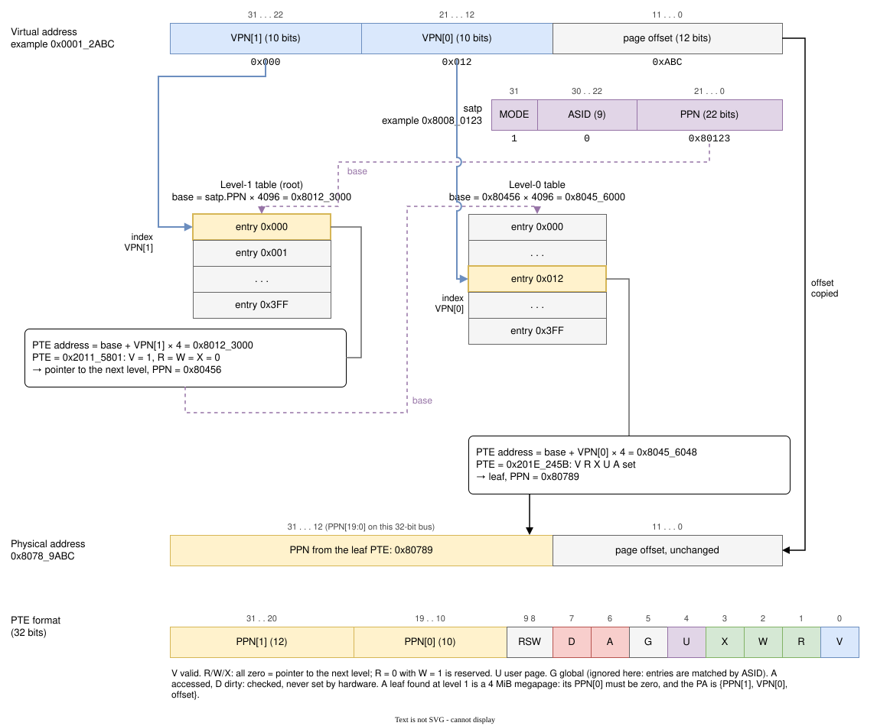
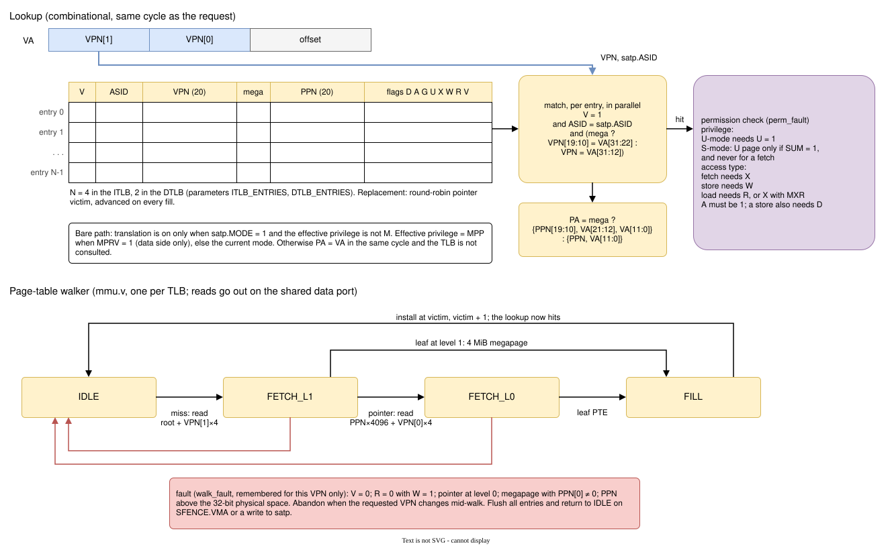

# 6. Virtual memory (Sv32)

Previous: [5. Privilege, CSRs and traps](05-privilege-and-traps.md) | [Book index](../README.md) | Next: [7. Caches](07-caches.md)

Virtual memory gives every process its own address space and lets the kernel
decide, page by page, what each process may read, write and execute. Harris &
Harris chapter 8 explains the concepts (pages, page tables, TLBs, page faults);
this chapter assumes them and shows the RISC-V Sv32 scheme and how Beresheet
implements it with two small TLBs and a hardware page-table walker.

## 6.1 Sv32 in one page

Sv32 splits a 32-bit virtual address (VA) into three fields:

| Bits | Field | Use |
|---|---|---|
| 31:22 | VPN[1] | Index into the level-1 (root) page table |
| 21:12 | VPN[0] | Index into a level-0 page table |
| 11:0 | page offset | Copied unchanged into the physical address |

A page table is one 4 KiB page holding 1024 four-byte **page-table entries**
(PTEs). The `satp` CSR holds the physical page number of the root table:

| `satp` bits | Field | Meaning |
|---|---|---|
| 31 | MODE | 0 = Bare (no translation), 1 = Sv32 |
| 30:22 | ASID | Address-space identifier, tags TLB entries |
| 21:0 | PPN | Physical page number of the root table |

A PTE is either a **pointer** to the next-level table (R = W = X = 0) or a
**leaf** that maps a page. A leaf in the root table maps a 4 MiB *megapage*; a
leaf in a level-0 table maps a 4 KiB page.

*Figure 6.1: A worked translation and the PTE format.*

### Worked example

Translate the virtual address `0x0001_2ABC` with `satp = 0x8008_0123`
(Sv32, ASID 0, root table at physical page `0x80123`):

1. Split the VA: VPN[1] = `0x000`, VPN[0] = `0x012`, offset = `0xABC`.
2. Read the level-1 PTE at `0x80123 x 4096 + 0x000 x 4 = 0x8012_3000`. It holds
   `0x2011_5801`: V = 1 and R = W = X = 0, so it is a pointer. Its PPN (bits
   31:10) is `0x80456`.
3. Read the level-0 PTE at `0x80456 x 4096 + 0x012 x 4 = 0x8045_6048`. It holds
   `0x201E_245B`: V, R, X, U and A are set, so it is a leaf for a user code page,
   PPN `0x80789`.
4. The physical address is `0x80789 x 4096 + 0xABC = 0x8078_9ABC`.

If step 2 had found a leaf, the page would be a 4 MiB megapage and the physical
address would be `{PPN[1], VPN[0], offset}`: the bottom ten bits of the PPN must
then be zero, or the PTE is malformed. Linux maps its own text this way, which is
why four ITLB entries cover 16 MiB of kernel code.

## 6.2 Two MMUs, two places in the pipeline

The same module, `mmu`, is instantiated twice:

| Instance | Translates | Where | Entries | Fault cause |
|---|---|---|---|---|
| `immu` (`IS_FETCH = 1`) | The fetch PC, `pc_f` | Stage 1 | `ITLB_ENTRIES = 4` | 12, instruction page fault |
| `dmmu` (`IS_FETCH = 0`) | The load/store address from the ALU | Stage 2 | `DTLB_ENTRIES = 2` | 13 load / 15 store page fault |

Placing the data translation in **stage 2** rather than in the memory stage is
what makes page faults precise for free: the address is already there for the
alignment check, so a page fault simply joins the existing set of exceptions
and the faulting instruction never reaches stage 3
([5.5](05-privilege-and-traps.md#55-traps-exceptions-and-interrupts)). What enters
EX/MEM, and therefore what the data cache sees, is the physical address.

A fetch that faults never becomes a bus request: the ITLB reports the fault,
`imem_req` stays low, and IF/ID receives a "poisoned" slot (`fault = 1`) that
raises the instruction page fault when it reaches stage 2, with the PC as
`mtval`/`stval`.

## 6.3 The TLB

*Figure 6.2: The TLB lookup (top) and the walker state machine (bottom).*

Each TLB is **fully associative**: every entry is compared at once. An entry
holds a valid bit, the ASID, a 20-bit VPN, a megapage flag, a 20-bit PPN and the
eight PTE flag bits. An entry matches when it is valid, its ASID equals
`satp.ASID`, and its VPN matches, comparing only VPN[1] for a megapage. The
physical address is then `{PPN, offset}`, or `{PPN[19:10], VPN[0], offset}` for
a megapage. The low ten PPN bits of a megapage are taken from the virtual
address *at use time*, so one entry serves all 1024 pages it covers.

Replacement is **round-robin**: one counter, `victim`, advanced on each fill. A
pseudo-LRU tree would put more logic on the address path for no measurable
benefit on a TLB this small.

### Why so small?

The DTLB compare sits at the end of the longest combinational path in the
machine: a load returning from the cache, through the write-back mux and the
register file bypass, through the ALU, into the TLB
([2.5](02-pipeline.md#25-data-hazards-the-write-through-bypass)). Each doubling of
the TLB adds a few nanoseconds there. The sizes were chosen by measuring timing
closure on the board at 24 MHz; the measurements are recorded in the comment
above the parameters in `riscv_core.v`. A miss is cheap in comparison: two reads
of a page table that is usually in the data cache. One instruction never needs
more than one data translation, so even two entries make progress.

## 6.4 When translation is on

Translation is **off**, and the MMU is a wire (`paddr = vaddr`, ready in the
same cycle), when `satp.MODE = 0` or when the effective privilege is M. This is
not just an optimisation: it is why the BIOS, OpenSBI and every M-mode handler
run exactly as fast as on a core without an MMU.

The *effective* privilege for data accesses honours `mstatus.MPRV`: an M-mode
load or store with MPRV set is translated and checked as if it came from the
mode in MPP. OpenSBI uses this to read the kernel's memory through the
kernel's own page tables. Instruction fetch always uses the real current mode.

## 6.5 Permission checks

On a hit, the entry's flags are checked against the access
(`access_allowed`). A failure is a page fault with no walk: the translation is
known, it is simply not allowed.

| Check | Rule |
|---|---|
| Valid | V = 1 |
| Privilege | In U: the page must have U = 1. In S: a U page is allowed only for loads and stores, and only with `mstatus.SUM = 1`; never for a fetch |
| Access type | Fetch needs X. Store needs W. Load needs R, or X when `mstatus.MXR = 1` |
| Accessed / dirty | A must be 1; a store also needs D = 1 |

**A and D are managed by software.** The hardware never writes a PTE. If a leaf
has A = 0, or a store finds D = 0, the access page-faults and the kernel sets
the bit and retries. The specification allows this, and Linux handles it; the
alternative, an atomic read-modify-write of the PTE from the walker, would need
far more hardware.

The G (global) bit is not used: every entry is matched by ASID, and
`SFENCE.VMA` flushes everything anyway ([6.7](#67-sfencevma-and-satp-writes)).

## 6.6 The page-table walker

On a miss with translation on, the walker in the same `mmu` instance reads the
page table, using the state machine at the bottom of Figure 6.2:

| State | Action |
|---|---|
| `IDLE` | On a miss: address `satp.PPN x 4096 + VPN[1] x 4`, raise `ptw_re`, latch the VPN being walked (`walk_vpn`) |
| `FETCH_L1` | Wait for `ptw_ready`. Invalid or reserved PTE: fault. Leaf: megapage, go to `FILL` (fault if PPN[0] is not zero or the PPN is above 4 GiB). Pointer: address `PTE.PPN x 4096 + VPN[0] x 4`, go to `FETCH_L0` |
| `FETCH_L0` | Wait for `ptw_ready`. Must be a valid leaf below 4 GiB, else fault. Go to `FILL` |
| `FILL` | Write the entry at `victim`, advance `victim`, back to `IDLE`. The lookup now hits |

The OR in `{PPN, 12'b0} | {VPN, 2'b00}` replaces an adder: the two fields
cannot overlap, so there is no carry.

**The walker reads through the core's data port.** A page-table read is an
ordinary physical memory read, so it goes through the same data cache as every
load, and page tables are cached like any other data. The data port is shared
three ways with fixed priority: the instruction in stage 3 first, then the data
walker, then the instruction walker. The data walker normally runs while its
load or store is held in stage 2 and stage 3 holds a bubble, so the port is
free; the instruction walker can find the port busy with an older load, and
waits.

Three details keep the walker correct in a pipeline where the requested
address can change under it:

- **A walk belongs to one VPN.** The VPN is latched when the walk starts. If
  the request moves to a different page mid-walk (the fetch side keeps moving
  the PC), the walk is abandoned rather than filling an entry with one page's
  number and another page's translation.
- **A fault belongs to one VPN, and is a result, not a gate.** `walk_fault` is
  remembered together with `fault_vpn`, and reported only while that same page
  is requested with translation on. It never prevents a new walk. A kernel that
  handles the fault and retries the instruction must see a fresh walk; an
  earlier design that kept the fault sticky made a page that faulted once
  unreachable forever, and Linux hung on exactly that.
- **A resident entry outranks a remembered fault**, for the same reason: after
  the handler fixes the mapping, the retry must succeed.

A data access that is already misaligned, or an instruction whose fetch
faulted, does not wait for a walk. The poisoned slot of a faulted fetch does
not request a data translation at all: its instruction bits are garbage, and
an early bug let such a phantom load occupy the walker and starve the
instruction walk that the trap was waiting for (test `20_ifault_phantom_load`).

## 6.7 SFENCE.VMA and satp writes

`SFENCE.VMA` tells the hardware that page tables have changed. Beresheet
invalidates **every** entry in both TLBs and resets both walkers, ignoring the
address and ASID operands: flushing more than asked is always allowed, and
address-selective flushing would need comparison logic in the TLB for no
benefit a kernel here would notice. A CSR write to `satp` triggers the same
flush, because entries cached under the old root may belong to a different
address space. The flush pulse (`sfence_req`) fires once, on the cycle the
instruction completes (for `satp`, on the commit cycle, after the new value is
written).

`SFENCE.VMA` is illegal in U, and in S when `mstatus.TVM = 1`. The caches are
physically tagged, so they need no flush when mappings change.

## 6.8 Physical addresses above 4 GiB

Sv32 PTEs hold a 22-bit PPN, which allows 34-bit physical addresses. This
machine's bus is 32 bits wide. A leaf whose PPN has either of its top two bits
set points at memory that does not exist here, so the walker reports a page
fault rather than silently wrapping it onto real memory.

## 6.9 Observation

Each MMU counts hits, misses and faults (`stat_hits`, `stat_misses`,
`stat_faults`), exported as `dbg_itlb_*` and `dbg_dtlb_*`. They are not memory
mapped; the simulation testbench reads them.

## Where this is in the RTL

| What | File | Names |
|---|---|---|
| The MMU: bare path, TLB, permission check, walker | `RTL/core/MMU.v` | `mmu`, `xlate_on`, `eff_priv`, `tlb_*`, `victim`, `hit`, `access_allowed`, `ptw_state`, `walk_vpn`, `walk_fault`, `fault_vpn`, `pf_cause` |
| The two instances, TLB sizes, data-port sharing | `RTL/core/riscv_core.v` | `immu`, `dmmu`, `ITLB_ENTRIES`, `DTLB_ENTRIES`, `dptw_grant`, `iptw_grant`, `dmem_op_d` |
| Translation stall and fault priority | `RTL/core/control_unit.v` | `xlate_stall`, `dmmu_fault`, `ifetch_fault`, `CAUSE_*_PAGE_FAULT` |
| SFENCE.VMA decode, flush pulse | `RTL/core/control_unit.v` | `is_sfence`, `sfence_req`, `csr_writes_satp` |
| `satp` and the MPRV/SUM/MXR bits | `RTL/core/CSR_unit.v` | `satp`, `mstatus_mprv`, `mstatus_sum`, `mstatus_mxr` |
| Unit testbench | `RTL/sim/unit/tb_mmu.v` | |
| Tests | `tests/rv32i/16_mmu.S`, `17_umode_mem.S`, `20_ifault_phantom_load.S` | |
