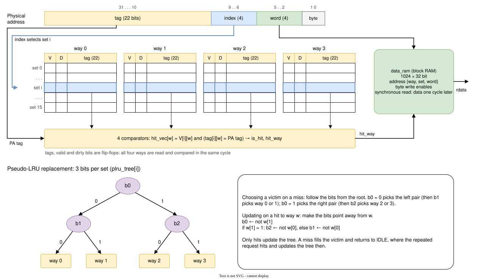
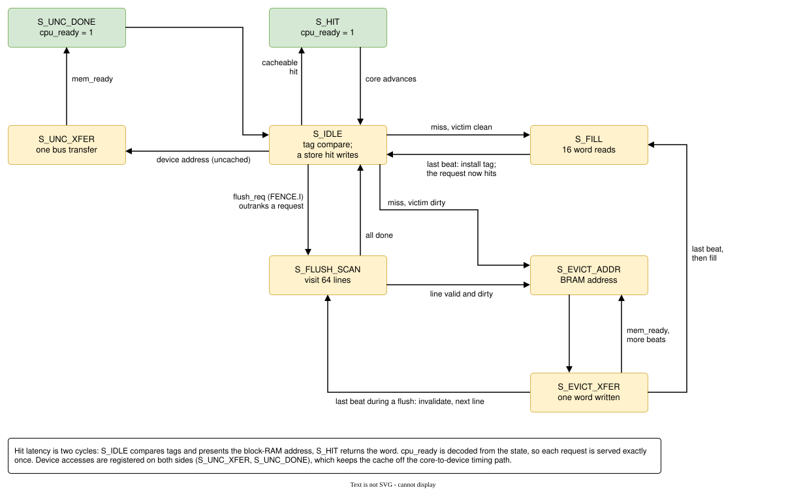

# 7. Caches

Previous: [6. Virtual memory](06-virtual-memory.md) | [Book index](../README.md) | Next: [8. Counters and timers](08-counters-and-timers.md)

The SDRAM on the board takes many cycles per access, and instruction fetch and
data accesses share one bus. Without caches, almost every instruction waits for
the bus twice. Beresheet has a 4 KB instruction cache and a 4 KB data cache.
Both are instances of the same Verilog module; the instruction cache is simply
the data cache with its write port tied off. Harris & Harris chapter 8 covers
the general theory (mapping, associativity, replacement, write policies); this
chapter describes the choices made here and the mechanics that make them work
on an FPGA.

## 7.1 Where the caches are

The caches are not inside `riscv_core`. They sit in the SoC (`soc_wb`), between
each core port and its Wishbone bridge ([Figure 0.1](00-overview.md#02-the-block-diagram)).
Both sides of a cache speak the same request/ready protocol as the core's
ports, so a cache is a drop-in shim: building the SoC with `DCACHE = 0` or
`ICACHE = 0` wires the core straight to the bridge, which is how a suspected
cache bug is separated from a suspected core bug.

| Parameter | I-cache | D-cache |
|---|---|---|
| Size | 4 KB (`ICACHE_SIZE`) | 4 KB (`DCACHE_SIZE`) |
| Line size | 64 bytes, 16 words | 64 bytes, 16 words |
| Associativity | 4-way | 4-way |
| Sets | 16 | 16 |
| Replacement | Pseudo-LRU | Pseudo-LRU |
| Write policy | Never writes | Write-back, write-allocate |
| Hit latency | 2 cycles | 2 cycles |

## 7.2 Organisation

With 16 sets of 4 ways of 64-byte lines, a 32-bit physical address splits into:

| Bits | Field | Width | Use |
|---|---|---|---|
| 31:10 | tag | 22 | Compared with the stored tags |
| 9:6 | index | 4 | Selects one of 16 sets |
| 5:2 | word | 4 | Selects one of 16 words in the line |
| 1:0 | byte | 2 | Handled by the byte strobes |

*Figure 7.1: Tag arrays in flip-flops, the data array in block RAM, and the
pseudo-LRU tree.*

The arrays are split by technology:

- **Tags, valid and dirty bits are flip-flops.** All four ways of the indexed
  set must be read and compared in the same cycle, so these must be readable
  combinationally (16 sets x 4 ways x 22 bits, about 1 400 flip-flops).
- **Data is one block RAM**, 1024 words of 32 bits, addressed `{way, set, word}`,
  with byte write enables. Block RAM on this FPGA cannot be read
  asynchronously, so a read takes one clock: the address goes in this cycle and
  the word comes out the next. An earlier version that read a whole 512-bit
  line combinationally needed 32 768 flip-flops, twice what the whole chip has.

That one-cycle block RAM read is why a **hit takes two cycles**: in `S_IDLE` the
tags are compared and the block RAM address of the hitting way is presented; in
`S_HIT` the word arrives and `cpu_ready` is raised.

### Virtually indexed? Here, physically indexed

The module is called `cache_vipt` and was designed as *virtually indexed,
physically tagged*: index and word offset from the virtual address
(`cpu_addr`), tag and cacheability from the physical one (`cpu_paddr`). That is
safe because 4 ways of 1 KB keep index plus offset (bits 9:0) inside the 12-bit
page offset, which translation never changes.

In this SoC, however, both TLBs translate *before* the address leaves the
core, so `soc_wb` connects the same physical address to both inputs. The caches
are therefore physically indexed and physically tagged in practice. Nothing is
lost: there are no aliasing problems either way, and the caches need no flush
when page mappings change.

## 7.3 What is cached

Each cache has two **cacheable windows**, both power-of-two sized and aligned
so that each test is one equality compare:

| Window | Base | Size | Contents |
|---|---|---|---|
| 1 | `0x8000_0000` | 8 MB | SDRAM |
| 2 | `0x0000_0000` | 32 KB | Boot RAM (the BIOS's code, data and stack) |

Everything else is a **device** and is never cached: the CLINT, PLIC, UART, LED
block and SD-card interface. A cached device read would return a stale copy, and
a cached device write might never reach the device; a cached `mtime` would stop
the clock. The boot RAM is cached because it is memory, and leaving it out made
the BIOS run slower with caches than without them.

Uncached accesses are **registered on both sides**: the request is captured in
`S_IDLE`, performed on the bus in `S_UNC_XFER`, and the answer returned from a
register in `S_UNC_DONE`. That costs two extra cycles per device access, and in
return it takes the cache's decode and read-data multiplexer off what was the
longest path in the SoC (core address to bus to device to register file in one
cycle).

## 7.4 The state machine

*Figure 7.2: The cache controller's states and transitions.*

| State | What happens |
|---|---|
| `S_IDLE` | Compare tags. A flush request wins over everything. A device address goes to `S_UNC_XFER`. A hit goes to `S_HIT` (a write hit writes the data array and sets the dirty bit in this cycle). A miss picks the pseudo-LRU victim and goes to `S_FILL`, or to `S_EVICT_ADDR` first if the victim is valid and dirty |
| `S_HIT` | The block RAM word is on `cpu_rdata`; `cpu_ready = 1` for this one cycle |
| `S_FILL` | Read the line, one word per bus transfer (16 beats), writing each into the data array. After the last beat install the tag, set valid, clear dirty, and return to `S_IDLE`, where the still-waiting request now hits |
| `S_EVICT_ADDR`, `S_EVICT_XFER` | Write a dirty line back, one word at a time: present the block RAM address, then hold the word on the bus until it is accepted. Then fill (on a miss) or continue the flush scan |
| `S_FLUSH_SCAN` | Visit all 64 lines; write back the dirty ones; invalidate all |
| `S_UNC_XFER`, `S_UNC_DONE` | One registered device transfer |

`cpu_ready` is decoded from the state, not registered. The core holds its
request until it sees `ready` and moves on at the clock edge that ends that
cycle. If `ready` were a register, it would still be high in the cycle after,
while the next request was already present, and the cache would answer every
request one access late (and write a store twice).

Returning from `S_FILL` to `S_IDLE` and hitting there costs two extra cycles on
a miss, but it means there is only one path that delivers data to the core.

## 7.5 Write-back, write-allocate

The data cache writes stores into the cache only and marks the line **dirty**;
the line is written to SDRAM when it is evicted, or when a `FENCE.I` flushes the
cache. A store miss first brings the whole line in (**write-allocate**), then
writes the word as a hit. Fills and evictions always move whole words with all
four byte strobes set; partial-word stores are applied to the block RAM with
byte enables.

## 7.6 Pseudo-LRU replacement

True LRU over four ways needs to remember a full ordering of the ways. A
**tree pseudo-LRU** uses three bits per set (`plru_tree[set]`) arranged as a
binary tree (Figure 7.1):

- **Victim**: start at the root. `b0 = 0` chooses the left pair, then `b1`
  chooses way 0 or 1; `b0 = 1` chooses the right pair, then `b2` chooses way 2
  or 3.
- **Update on a hit to way `w`**: point every bit on the path *away* from `w`:
  `b0 <= ~w[1]`, and `b2 <= ~w[0]` if `w[1] = 1`, otherwise `b1 <= ~w[0]`.

Only hits update the tree. That is enough, because every miss ends with the
same request hitting the freshly filled line. All trees reset to `000`, so the
first victim in every set is way 0.

## 7.7 FENCE.I: making stores visible to fetch

The two caches are not coherent with each other. A program that writes
instructions (a boot loader copying a kernel, a kernel loading a module, a JIT)
leaves them dirty in the *data* cache, while the *instruction* cache may hold
whatever was at those addresses before, and its misses read SDRAM, which may
not have the new bytes yet. `FENCE.I` is the instruction that makes the two
agree, and Beresheet implements it by brute force:

1. **The core asks.** When `FENCE.I` is in stage 2 and no data access is in
   flight, the control unit raises `fence_i_req`. Waiting for stage 3 to be
   quiet matters: a store just ahead of the `FENCE.I` must land in the cache
   *before* the flush starts, or the flush would write back the old line and
   the store would be left behind, dirty again.
2. **The SoC sequencer flushes both caches.** A small state machine in `soc_wb`
   (`FL_IDLE`, `FL_GO`, `FL_WAIT`) raises a separate flush request to each cache
   and drops each one as soon as that cache acknowledges by raising its
   `flush_busy`. (An earlier version waited for both to be busy at the same
   time, which need not ever happen.) The data cache writes every dirty line
   back and invalidates everything; the instruction cache, which has no dirty
   lines, just invalidates.
3. **The core waits for two edges.** `cache_flush_busy` must first be *seen
   high* (`fence_seen`), and only its fall releases the instruction. Waiting
   only for "busy low" would release it in the very first cycle, before anything
   has started. To guarantee the rise, the SoC drives `cache_flush_busy` high
   combinationally in the request cycle itself.

A flush visits all 64 lines and writes back at most 64 x 16 words, so it always
completes in bounded time.

## 7.8 Atomics, page walks and the caches

- **Page-table walks** go through the data cache like any load, so recently used
  PTEs are usually hits.
- **Atomics** on cacheable memory are performed inside the data cache; the only
  other bus master is instruction fetch, which never writes, so nothing can come
  between the read and the write. The bus `LOCK` is forwarded only for an
  uncached transfer ([4.3](04-a-extension.md#43-the-sequencer)).

## Where this is in the RTL

| What | File | Names |
|---|---|---|
| Cache module: geometry, windows, arrays, PLRU, FSM | `RTL/core/cache.v` | `cache_vipt`, `CACHEABLE_BASE/SIZE`, `CACHEABLE2_BASE/SIZE`, `tag_ram`, `valid_ram`, `dirty_ram`, `plru_tree`, `data_ram`, `victim_way`, `S_*` states, `cpu_ready`, `flush_busy` |
| Instances, window parameters, `DCACHE`/`ICACHE` switches | `RTL/soc/soc_wb.v` | `g_dcache`, `g_icache` |
| FENCE.I sequencer | `RTL/soc/soc_wb.v` | `fl_state`, `d_req`, `i_req`, `cache_flush_busy` |
| FENCE.I in the core | `RTL/core/control_unit.v` | `is_fence_i`, `fence_seen`, `fence_i_req`, `fence_stall` |
| Unit testbench | `RTL/sim/unit/tb_dcache.v` | |
| Test | `tests/rv32i/15_fence.S`; the BIOS's Zifencei self-test | |
