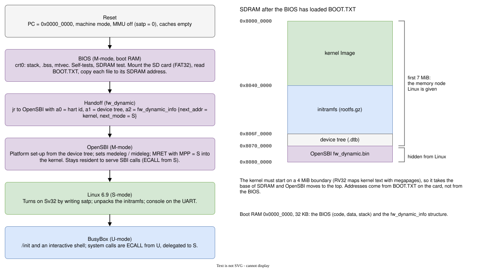

# 9. From reset to a shell

Previous: [8. Counters and timers](08-counters-and-timers.md) | [Book index](../README.md) | Next: [10. Limitations and known issues](10-limitations.md)

This chapter follows the machine from the moment reset is released to the
BusyBox prompt, from the core's point of view: which mode it is in, what the
MMU and caches are doing, and which mechanisms from the previous chapters each
stage relies on. The devices involved (SD card, UART, SDRAM controller) are
described in Part III, [peripherals](../peripherals/README.md), and the bus in
Part II, [the bus](../bus/README.md).

*Figure 9.1: Boot stages (left) and the SDRAM contents after the BIOS has
loaded the boot set (right).*

## 9.1 Reset

On the board, a counter on the PLL output holds the SoC in reset for 65 536
cycles after power-up, long enough for the PLL to lock. When reset is released
the core is in machine mode, `pc_f = 0x0000_0000`, `satp = 0` (no
translation), interrupts disabled (`mstatus.MIE = 0`, `mie = 0`), `mtvec = 0`,
and both caches and both TLBs empty. All 31 general registers are zero, because
the register file is built from flip-flops with a reset (software should not
rely on that).

## 9.2 The BIOS (machine mode, boot RAM)

Address `0x0000_0000` is the 32 KB boot RAM, initialised from the bitstream
with the BIOS (`firmware/bios`). Its start-up code, `crt0.S`, sets the stack
pointer to the top of boot RAM and the global pointer, clears `.bss`, and
installs `trap_entry` in `mtvec` (direct mode) before calling `main`, so any
fault from then on is reported instead of halting the core.

`main` brings up the UART first (so that everything after it is observable),
prints the banner ("Beresheet RV32IMA", clock, baud rate, memory map, `misa`),
and runs self-tests of the CPU, the CSRs, traps, the timer, the PLIC and the
atomics. A build without a preloaded image also tests the SDRAM, atomics in
SDRAM, `FENCE.I` through both caches, and the MMU.

A boot-from-SD build then:

1. initialises the SD card in SPI mode and mounts its FAT32 partition;
2. reads the text file `BOOT.TXT`, one line per file: a *role*, a file name and
   a load address (the boot-plan addresses are zeroed before parsing, so a
   missing entry cannot inherit a stale value);
3. refuses any file that would not fit inside SDRAM, so a typo cannot overwrite
   the BIOS while it is running;
4. copies each file to its address (through the data cache) and prints its
   first word as a sanity check.

The boot set used for Linux is:

| Role | File | Address |
|---|---|---|
| `kernel` | `Image` | `0x8000_0000` |
| `load` | `rootfs.gz` (the initramfs) | `0x8040_0000` |
| `dtb` | the device tree blob | `0x806F_0000` |
| `sbi` | `fw_dynamic.bin` (OpenSBI) | `0x8070_0000` |

The layout is forced by two facts. RV32 Linux maps its own text with 4 MiB
megapages, so the kernel must start on a 4 MiB boundary; with 8 MiB of SDRAM
there are only two such slots and the kernel only fits in the first. OpenSBI
therefore goes to the top, and the device tree's memory node declares only the
first 7 MiB, so Linux never allocates over the firmware.

### The handoff

The BIOS disables interrupts and jumps to OpenSBI using OpenSBI's
**fw_dynamic** convention:

| Register | Value |
|---|---|
| `a0` | hart ID (`mhartid`, always 0) |
| `a1` | address of the device tree |
| `a2` | address of a `fw_dynamic_info` structure in boot RAM: magic `"OSBI"`, version 2, `next_addr` = the kernel, `next_mode` = S |

The core is still in M with translation off. Note that the BIOS jumps to code it
has just written through the write-back data cache; see
[10.3](10-limitations.md#103-known-issues) for why that deserves a `FENCE.I`.

## 9.3 OpenSBI (machine mode)

OpenSBI reads the device tree, sets up the UART, the CLINT and the PLIC, and
configures the core for an operating system: it writes `medeleg` and `mideleg`
so that page faults, system calls from U and the supervisor interrupts go
straight to the kernel ([5.5](05-privilege-and-traps.md#55-traps-exceptions-and-interrupts)),
sets `mcounteren`, and probes optional CSRs (the absent ones, such as PMP,
answer with an illegal-instruction trap, which OpenSBI expects). It then sets
`mstatus.MPP = S`, `mepc` = the kernel entry and executes `MRET`.

OpenSBI stays resident in the last MiB. From now on it runs only when the
kernel calls it (`ECALL` from S, cause 9: timer programming, console output,
reboot) or when a machine-mode interrupt arrives (the machine timer, which it
forwards as `mip.STIP`; [8.3](08-counters-and-timers.md#83-timer-interrupts)). It
uses `mstatus.MPRV` to read kernel memory through the kernel's page tables.

## 9.4 Linux (supervisor mode)

The kernel starts in S with translation off. Its early code builds a trampoline
page table and writes `satp` (MODE = Sv32), which also flushes both TLBs
([6.7](06-virtual-memory.md#67-sfencevma-and-satp-writes)). The next fetch is
translated; the kernel arranges for that fetch to fault into a trap vector at
the kernel's virtual address, and continues there. It then builds its final
page tables, unpacks the initramfs into a RAM file system, and starts `/init`
in user mode with an `SRET` (SPP = U).

## 9.5 BusyBox (user mode)

`/init` and the shell run in U-mode. Every system call is an `ECALL` from U
(cause 8), delegated to the kernel. Every first touch of a page is a page fault
(cause 12, 13 or 15), also delegated; the kernel fills in the mapping, sets the
A and D bits where needed (the hardware never does, [6.5](06-virtual-memory.md#65-permission-checks)),
and returns with `SRET` to retry the instruction. The console is the UART; in
the normal build its interrupt reaches the kernel through the PLIC's supervisor
context and `mip.SEIP` (the device tree can also describe a polled console).

## Where this is in the RTL and firmware

| What | File | Names |
|---|---|---|
| Reset vector | `RTL/core/definitions.vh` | `PC_INIT_VALUE` |
| Power-on reset, PLL | `RTL/fpga/tangnano20k/top_tang_nano_20k.v`, `gowin_rpll.v` | `por_cnt`, `rst` |
| Boot RAM contents | `RTL/soc/soc_wb.v` | `bootram`, `BOOT_INIT` |
| BIOS start-up | `firmware/bios/crt0.S` | `_start`, `trap_entry` |
| BIOS main flow and self-tests | `firmware/bios/main.c` | `main`, `fence_i_selftest`, `mmu_selftest` |
| SD boot loader and fw_dynamic handoff | `firmware/bios/boot.c`, `boot.h` | `boot_load_from_sd`, `boot_handoff`, `BOOT_DESC_FILE` |
| Machine description for OpenSBI and Linux | `firmware/dts/beresheet.dts` | `memory@80000000`, `riscv,isa`, `mmu-type` |
