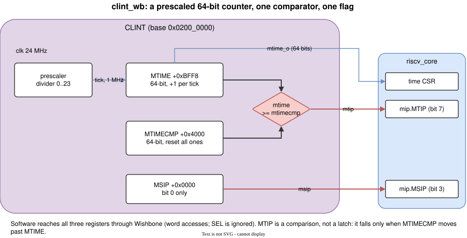
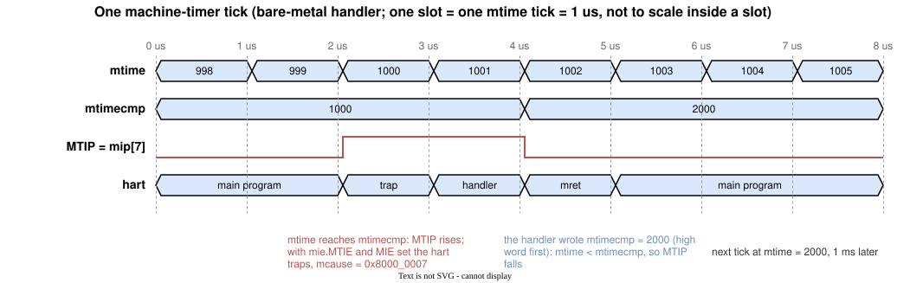

# 1. CLINT: timer and software interrupt

## The idea: an alarm clock for the processor

An operating system must get control back from a running program
periodically, even if the program never makes a system call. The usual tool is
a **timer interrupt**: a counter that runs on its own, and a compare register
that says "interrupt me when the counter gets here". The handler does its work
(for Linux: maybe switch to another process), sets the next deadline, and
returns.

RISC-V specifies this machine exactly. The **CLINT** (Core-Local INTerruptor;
the current specification is called ACLINT) has three registers:

| Register | Width | Meaning |
|----------|-------|---------|
| `mtime` | 64 bit | Counts up at a fixed rate, independent of the CPU clock |
| `mtimecmp` | 64 bit | The deadline. The timer interrupt is pending while `mtime >= mtimecmp` |
| `msip` | 1 bit (in a 32-bit word) | Software interrupt: writing 1 raises a machine software interrupt |

These are **memory-mapped** registers, not CSRs. The privileged specification
deliberately has no `mtime` CSR; firmware finds the CLINT through the device
tree and writes it with ordinary stores. (There is a read-only `time` CSR; see
below.)



## Register map

The base address is the SoC's choice; the offsets are fixed by the ACLINT
specification (they match the older SiFive CLINT layout), which is what lets
OpenSBI's standard driver work unmodified.

| Address | Register | Access |
|---------|----------|--------|
| `0x0200_0000` | `MSIP0`, bit 0 | read/write |
| `0x0200_4000` | `MTIMECMP0` low word | read/write |
| `0x0200_4004` | `MTIMECMP0` high word | read/write |
| `0x0200_BFF8` | `MTIME` low word | read/write |
| `0x0200_BFFC` | `MTIME` high word | read/write |

Any other offset reads as zero and ignores writes. All accesses are whole
words; `SEL` is ignored. The "0" in the names is the hart number: Beresheet has
one hart.

Reset values: `mtime = 0`, `msip = 0`, and `mtimecmp = 0xFFFF_FFFF_FFFF_FFFF`.
All ones means "never", so no timer interrupt is pending before software has
set a deadline. With `mtimecmp = 0` the interrupt would be pending from the
first cycle.

## The time base: 24 MHz down to 1 MHz

`mtime` should tick at a fixed, known rate. The CLINT divides the system clock
with a prescaler:

```
DIVIDER = CPU_HZ / TICK_HZ = 24 000 000 / 1 000 000 = 24
```

A counter runs 0 to 23; when it reaches 23 it wraps and `mtime` increments.
So `mtime` counts **microseconds**. That rate is what the device tree
announces as `timebase-frequency = <1000000>`. If those two disagreed, every
timeout in Linux would be wrong by the same ratio, which looks like a hang
rather than a bad number. (The 24 MHz system clock was chosen partly because
it divides evenly to 1 MHz.)

## How the interrupt is raised and cleared

```verilog
assign mtip = (mtime >= mtimecmp);    // 64-bit unsigned compare
```

`mtip` is a **comparison, not a latch**. It goes straight to `mip.MTIP`, which
is therefore read-only in the core. There is no "acknowledge" bit. The only way
to clear a timer interrupt is to move `mtimecmp` past `mtime`. A handler that
forgets to do so is re-entered immediately after `mret` and the machine
appears to hang inside its own timer.



The BIOS handler (`firmware/bios/trap.c`) does exactly this on cause 7:

```c
case 7:                                  /* machine timer */
    timer_ticks++;
    clint_next_tick(timer_period_us);    /* mtimecmp = mtime + period */
    break;
```

### Writing a 64-bit register with 32-bit stores

RV32 can store only 32 bits at a time, so `mtimecmp` is written in two halves.
In between, it briefly holds a mix of old and new values, which could be
*smaller* than `mtime` and fire a spurious interrupt. The safe order (used by
`clint_set_timecmp` in `firmware/bios/clint.h`, and by OpenSBI) is:

1. write the high word to `0xFFFF_FFFF` (now the value is huge: no interrupt);
2. write the low word;
3. write the real high word.

Reading `mtime` has the mirror problem: the low word can wrap between the two
loads. The BIOS reads high, low, high again, and retries if the two high
values differ.

### The `time` CSR

The CLINT also exports `mtime` directly to the core (`mtime_o`), which serves
it as the `time`/`timeh` CSRs (Zicntr). Reading the time with `rdtime` takes
no bus access and works in any privilege mode the counter-enable CSRs allow.
Linux's clock source uses it.

## The software interrupt

`msip` is a one-bit register. Writing 1 to `0x0200_0000` sets `mip.MSIP`;
writing 0 clears it. On a multi-hart system this is how one hart pokes another
(an inter-processor interrupt). With one hart, it is mostly useful for testing:
the BIOS handler for cause 3 simply writes 0 back.

## Who uses the CLINT under Linux

Linux runs in supervisor mode and does not touch the CLINT. OpenSBI, in machine
mode, owns it:

- Linux asks for the next timer interrupt with an SBI call (`sbi_set_timer`);
  OpenSBI writes `mtimecmp`.
- When `MTIP` fires, OpenSBI's machine-mode handler masks it and sets
  `mip.STIP`, which Linux sees as a supervisor timer interrupt.

The [interrupt path chapter](06-interrupt-path.md) follows that sequence in
detail. The core has no Sstc extension (no `stimecmp`), so this indirection is
the only way for Linux to get a timer.

## Where this is in the RTL

| What | File | Key signals |
|------|------|-------------|
| CLINT | `RTL/peripherals/clint/clint_wb.v` | `divider`, `tick`, `mtime`, `mtimecmp`, `msip_r`, `mtip`, `msip`, `mtime_o`, `OFF_*` |
| Instance and wiring to the core | `RTL/soc/soc_wb.v` | `clint`, `irq_timer`, `irq_soft`, `mtime` |
| `mip` bits and `time` CSR | `RTL/core/CSR_unit.v` | `mip_val`, `irq_timer`, `irq_soft`, `CSR_TIME` |
| BIOS driver | `firmware/bios/clint.h`, `trap.c` | `clint_mtime`, `clint_set_timecmp`, `clint_next_tick` |
| Device tree node | `firmware/dts/beresheet.dts` | `clint@2000000`, `timebase-frequency` |
