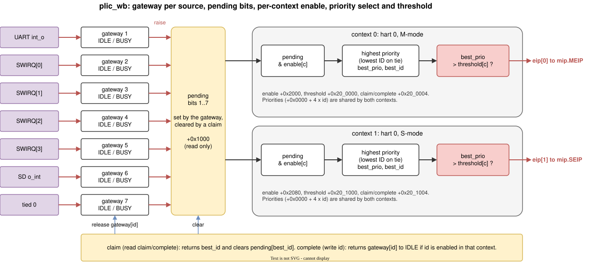
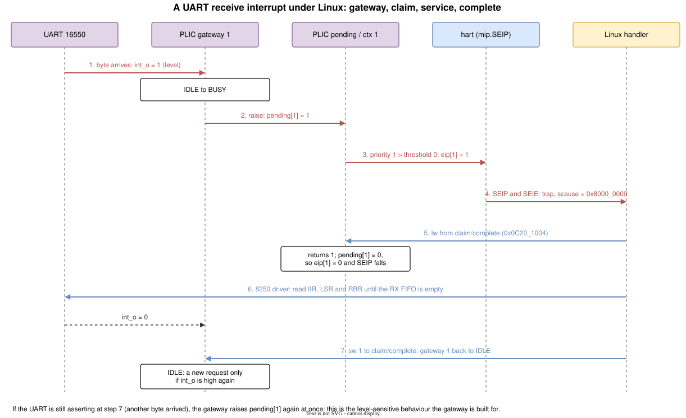

# 2. PLIC: external interrupts

## The idea: many devices, one wire

A core has room for only a few interrupt inputs, but a system can have dozens
of devices. The **PLIC** (Platform-Level Interrupt Controller) collects all
device interrupts and presents the core with a single "external interrupt"
wire per privilege mode. When that wire is high, software asks the PLIC
*which* device it was, handles that device, and tells the PLIC it is done.

The PLIC is specified by RISC-V (the *RISC-V Platform-Level Interrupt
Controller Specification*). Beresheet implements its register layout exactly,
so OpenSBI's and Linux's standard `riscv,plic0` drivers work unchanged.

## Sources and contexts

**Sources** are the device interrupt lines, numbered from 1. Source 0 does not
exist; reading "0" from the claim register means "nothing pending".

| Source | Driven by | Used by |
|--------|-----------|---------|
| 1 | UART 16550 `int_o` | Linux serial driver |
| 2 to 5 | LED block `SWIRQ[0..3]` | BIOS self-test; software-triggered |
| 6 | SD card controller `o_int` | Wired, unused (the BIOS polls) |
| 7 | tied low | spare |

So `NUM_SRCS = 8` (ids 0 to 7, seven usable), which is why the device tree says
`riscv,ndev = <7>`.

A **context** is one privilege mode on one hart: an independent set of enable
bits, a threshold and a claim register, with its own output wire.

| Context | Hart, mode | Output | Core input |
|---------|-----------|--------|------------|
| 0 | hart 0, M-mode | `eip[0]` | `mip.MEIP` (bit 11) |
| 1 | hart 0, S-mode | `eip[1]` | `mip.SEIP` (bit 9) |

Under Linux, the kernel drives context 1: the device tree lists both contexts
in `interrupts-extended`, and Linux picks the one wired to a supervisor-mode
interrupt (9). The BIOS, which runs in M-mode, uses context 0.

## Three mechanisms



It helps to keep the three parts apart.

### 1. The gateway: one request per event

Each source has a two-state gateway. In `IDLE`, if the source line is high, the
gateway sets that source's **pending** bit and moves to `BUSY`. In `BUSY` it
ignores the line entirely, until software **completes** that source.

Why? All Beresheet sources are **level-sensitive**: a device holds its line
high until it has been serviced. Without the gateway, the pending bit would be
set again the instant software cleared it, and the interrupt would never go
away. The gateway turns "line is high" into exactly one request, and refuses to
make another until software says the previous one is finished.

On completion the gateway goes straight back to `IDLE`. If the line is *still*
high at that moment, a new request is raised on the next cycle. That is the
specified behaviour for a level-sensitive source, and it matters: an earlier
version waited for the line to go low first (edge behaviour). When a byte
arrived at the UART during transmission, the line stayed high through
completion, the gateway waited for a fall that never came, and the Linux
console stopped reading input after one command.

### 2. The core: pick a winner, compare with the threshold

For each context, the PLIC considers the sources that are both **pending** and
**enabled** in that context. Each source has a **priority** from 0 to 7 (shared
by all contexts):

- priority 0 means "never interrupt": the source is disabled;
- among the candidates, the highest priority wins; on a tie, the lowest
  source id wins.

The context's output is raised when the winner's priority is **strictly
greater** than the context's **threshold**:

```verilog
assign eip[c] = (best_prio[c] > threshold_r[c]);
```

A threshold of 0 lets every enabled source with non-zero priority through; a
threshold of 7 masks everything. This is computed combinationally from the
registers, so `eip` follows a change of pending, enable, priority or threshold
in the same cycle.

### 3. Claim and complete: the software handshake

Each context has one register at offset `+4` of its context block, used two
ways:

- **Claim (read).** Returns the id of the current winner for that context and,
  in the same cycle, **clears its pending bit**. With the pending bit clear,
  `eip` drops, so the handler is not interrupted again while it works. Reading
  0 means there was nothing to claim (a spurious interrupt); do not complete it.
- **Complete (write the id).** Releases that source's gateway back to `IDLE`. A
  completion is honoured only if that source is enabled in the context written
  to; otherwise it is silently ignored, as the specification requires.

The claim is the only read in the SoC with a side effect, which is one more
reason why device regions must never be cached.



The order inside a handler is therefore always:

1. claim, to learn the id and drop the interrupt;
2. service the device until it lowers its line;
3. complete, to re-arm the gateway.

The BIOS version (`plic_service` in `firmware/bios/trap.c`) is ten lines long
and a good first read.

## Register map

Offsets from the PLIC base `0x0C00_0000`, fixed by the specification:

| Offset | Register | Access | Notes |
|--------|----------|--------|-------|
| `0x00_0000 + 4 x id` | priority[id] | read/write | 3 bits (0 to 7); priority[0] ignores writes |
| `0x00_1000` | pending[7:0] | read only | bit 0 always 0; cleared only by a claim |
| `0x00_2000` | enable, context 0 | read/write | bit per source; bit 0 forced to 0 |
| `0x00_2080` | enable, context 1 | read/write | |
| `0x20_0000` | threshold, context 0 | read/write | 3 bits |
| `0x20_0004` | claim/complete, context 0 | read: claim, write: complete | |
| `0x20_1000` | threshold, context 1 | read/write | |
| `0x20_1004` | claim/complete, context 1 | read: claim, write: complete | |

Everything else in the 4 MB block reads as zero and ignores writes. The decoder
is tightened on purpose, so that, for example, `0x20_0008` does not alias onto
a claim register. All accesses are whole words; `SEL` is ignored.

Two deliberate choices, both recorded in the RTL header:

- **pending is read-only**, as the specification says ("a pending bit ... can be
  cleared by setting the associated enable bit then performing a claim").
  Writable pending bits would be a handy test hook and an unfaithful device.
- **complete is a one-cycle pulse**, not a stored register. Stored, it would
  keep matching the last completed id forever and the gateway would never stay
  `BUSY`.

## Setting it up (bare metal)

Adapted from the PLIC self-test in `firmware/bios/main.c`, using the helpers in `firmware/bios/plic.h`:

```c
plic_set_priority(PLIC_SRC_SW(0), 5);     /* source 2, priority 5        */
plic_set_threshold(PLIC_CTX_M0, 0);       /* let everything above 0 in   */
plic_enable(PLIC_CTX_M0, PLIC_SRC_SW(0), 1);
/* then set mie.MEIE and mstatus.MIE, and raise SWIRQ bit 0 */
```

## Where this is in the RTL

| What | File | Key signals |
|------|------|-------------|
| PLIC | `RTL/peripherals/plic/plic_wb.v` | `gw_state`, `gw_raise`, `pending_r`, `priority_r`, `enable_r`, `threshold_r`, `best_prio`, `best_id`, `eip`, `claim_now`, `complete_now` |
| Source wiring | `RTL/soc/soc_wb.v` | `plic_src`, `uart_irq`, `swirq`, `sd_irq`, `plic_eip` |
| Geometry and source numbers | `RTL/bus/wb_defines.vh` | `PLIC_SRCS`, `PLIC_CTXS`, `PLIC_MAX_PRIO`, `PLIC_SRC_*` |
| `mip.MEIP` and `mip.SEIP` | `RTL/core/CSR_unit.v` | `irq_ext`, `irq_ext_s`, `mip_seip_sw` |
| BIOS driver | `firmware/bios/plic.h`, `trap.c` | `plic_claim`, `plic_complete`, `plic_service` |
| Unit testbench | `RTL/sim/unit/tb_plic.v` | |
| Device tree node | `firmware/dts/beresheet.dts` | `plic@c000000`, `interrupts-extended`, `riscv,ndev` |
