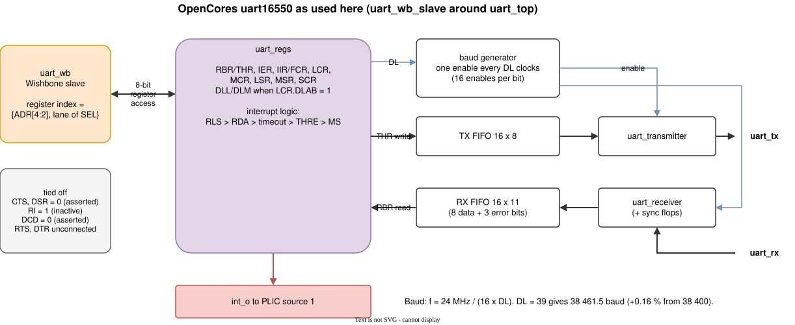

# 3. UART 16550

## The idea: bytes on one wire

A UART (Universal Asynchronous Receiver/Transmitter) sends a byte as a
sequence of bits on a single wire, at an agreed rate, with no clock line. Each
character is framed by a start bit (0) and one or more stop bits (1), so the
receiver can find the beginning of every byte. Beresheet uses the common
**8N1** format: 8 data bits, no parity, 1 stop bit, so 10 bit times per
character. On the Tang Nano 20K the UART pins go to the on-board USB-serial
bridge, and the PC sees a serial port.

The **16550** is a UART from the 1980s whose register interface became the de
facto standard. Every operating system has a driver for it; Linux's is called
`8250`. Using a 16550-compatible UART means no driver has to be written.

## Third-party RTL

The UART is the OpenCores **uart16550** core by Jacob Gorban and Igor Mohor,
distributed under the **GNU Lesser General Public License** (see the header of
each file). The files are kept as close to upstream as possible, so a diff
against upstream shows only the local changes. There is one:

- `uart_defines.v` defines `LITLE_ENDIAN` (the upstream spelling, with one T).

Why: the core is built in its 32-bit bus mode (`DATA_BUS_WIDTH_8` is left
undefined). In that mode `uart_wb.v` does not take the two low bits of the
register number from the address; it takes them from **which byte lane SEL
selects**. Upstream's default mapping is big-endian (`SEL = 0001` means register
3), which reverses the register order for a little-endian CPU such as RISC-V.
With `LITLE_ENDIAN` defined, a byte access at `UART_BASE + N` reaches register
`N`, the classic 16550 layout.

`uart_wb_slave.v` is Beresheet's own wrapper. It passes `ADR[4:0]` and the bus
signals through, and ties off the modem-control pins the board does not have:
CTS and DSR low (asserted, since they are active low), RI high (inactive), DCD
low (carrier present). RTS and DTR are left unconnected.



## Register map

All registers are 8 bits wide and accessed with byte loads and stores (`lb`,
`lbu`, `sb`). Base `0x1000_0000`.

| Offset | Read (DLAB = 0) | Write (DLAB = 0) | When LCR.DLAB = 1 |
|--------|-----------------|------------------|-------------------|
| 0 | RBR: received byte | THR: byte to send | DLL: divisor, low byte |
| 1 | IER: interrupt enable | IER | DLM: divisor, high byte |
| 2 | IIR: interrupt identification | FCR: FIFO control | (unchanged) |
| 3 | LCR: line control | LCR | (unchanged) |
| 4 | reads 0 | MCR: modem control | (unchanged) |
| 5 | LSR: line status | (ignored) | (unchanged) |
| 6 | MSR: modem status | (ignored) | (unchanged) |
| 7 | SCR: scratch | SCR | (unchanged) |

**DLAB** (Divisor Latch Access Bit, LCR bit 7) is the 16550's way of fitting
ten registers into eight addresses: while it is 1, offsets 0 and 1 reach the
two bytes of the baud divisor instead of the data and interrupt-enable
registers. Software sets DLAB, writes the divisor, and clears DLAB again.

Two quirks of this implementation: MCR is write-only (reads return 0), and the
FIFOs are always on (FCR bit 0 is ignored).

The bits that matter most:

| Register | Bit | Name | Meaning |
|----------|-----|------|---------|
| IER | 0 | ERBFI | Interrupt on received data (and receive timeout) |
| IER | 1 | ETBEI | Interrupt when the transmit FIFO becomes empty |
| IER | 2 | ELSI | Interrupt on receive line errors |
| IER | 3 | EDSSI | Interrupt on modem-status change |
| LSR | 0 | DR | At least one byte in the receive FIFO |
| LSR | 1 to 4 | OE, PE, FE, BI | Overrun, parity, framing error, break |
| LSR | 5 | THRE | Transmit FIFO empty: room for up to 16 bytes |
| LSR | 6 | TEMT | Transmitter completely idle (FIFO and shift register) |
| LCR | 1:0 | WLS | Word length; `11` = 8 bits |
| LCR | 7 | DLAB | Divisor latch access |
| FCR | 1, 2 | | Clear receive FIFO, clear transmit FIFO |
| FCR | 7:6 | | Receive trigger level: 1, 4, 8 or 14 bytes |

Reset state: LCR = `0x03` (8N1), IER = 0, divisor = 0, receive trigger 14. A
divisor of 0 stops the baud generator, so nothing is sent until software
programs one.

## The baud divisor at 24 MHz

The baud generator produces one enable pulse every DL clock cycles (DL is the
16-bit value in DLM:DLL). The transmitter and receiver use **16 enables per
bit**, which lets the receiver sample in the middle of each bit. So:

```
baud = f_clk / (16 x DL)        DL = round(f_clk / (16 x baud))
```

With the 24 MHz system clock:

| Wanted baud | f / (16 x baud) | DL | Actual baud | Error |
|-------------|-----------------|----|-------------|-------|
| 38 400 | 39.06 | **39** | 38 461.5 | +0.16 % |
| 115 200 | 13.02 | 13 | 115 384.6 | +0.16 % |
| 1 500 000 | 1 | 1 | 1 500 000 | 0 |

A UART link tolerates a few percent of mismatch, so +0.16 % is harmless.
Beresheet's console runs at **38 400 baud**. The BIOS computes
`CPU_HZ / (16 * BAUD)` with integer division (39), and Linux's 8250 driver gets
the same 39 from `clock-frequency = <24000000>` in the device tree. The
simulation build uses DL = 1, because simulated time runs at the real bit rate
and 38 400 baud would make the console dominate a simulation.

The BIOS initialisation is six byte stores (`firmware/bios/uart.c`):

```c
mmio_w8(UART_BASE + UART_LCR, LCR_DLAB);          /* expose the divisor  */
mmio_w8(UART_BASE + UART_DLL, divisor & 0xFF);    /* 39                  */
mmio_w8(UART_BASE + UART_DLM, divisor >> 8);      /* 0                   */
mmio_w8(UART_BASE + UART_LCR, LCR_8N1);           /* 0x03, DLAB off      */
mmio_w8(UART_BASE + UART_FCR, FCR_ENABLE | FCR_CLR_RX | FCR_CLR_TX);
mmio_w8(UART_BASE + UART_IER, 0x00);              /* polled              */
```

## FIFOs

- **Transmit FIFO:** 16 entries of 8 bits. Software may write up to 16 bytes
  whenever LSR.THRE is 1.
- **Receive FIFO:** 16 entries of 11 bits: the byte plus its parity-error,
  framing-error and break flags, so the error status stays with the character
  that caused it.

The FIFOs are what make the UART usable from an interrupt-driven OS: instead of
one interrupt per character, the CPU gets one interrupt per burst.

## Interrupts

The UART has one interrupt output, `int_o`, wired to **PLIC source 1**. It is
level-sensitive: it stays high until the condition is serviced. Five
conditions can raise it, in fixed priority order. IIR reports the
highest-priority one that is pending (reads as `0xC1` when none is):

| Priority | Condition | Enabled by | IIR | Cleared by |
|----------|-----------|------------|-----|------------|
| 1 (highest) | Receiver line status: overrun, parity, framing, break | IER bit 2 | `0xC6` | Reading LSR |
| 2 | Received data at or above the trigger level | IER bit 0 | `0xC4` | Reading RBR until below the trigger level |
| 3 | Receive timeout: data waiting, nothing new for about 4 character times | IER bit 0 | `0xCC` | Reading RBR |
| 4 | Transmit FIFO empty | IER bit 1 | `0xC2` | Writing THR, or reading IIR while it shows this |
| 5 | Modem status change | IER bit 3 | `0xC0` | Reading MSR |

The timeout interrupt is what delivers the last few bytes of a burst that did
not reach the trigger level, such as a single keypress.

## How Linux drives it

The device tree node:

```dts
serial@10000000 {
    compatible = "ns16550a";
    reg = <0x10000000 0x00000020>;
    reg-shift = <0>;              /* register N at base + N  */
    reg-io-width = <1>;           /* byte accesses           */
    clock-frequency = <24000000>; /* the UART's input clock  */
    current-speed = <38400>;
    interrupt-parent = <&plic>;
    interrupts = <1>;             /* PLIC source 1           */
};
```

1. **Early boot.** `earlycon=uart8250,mmio,0x10000000` prints kernel messages
   by polling THRE from the first instructions, before any driver exists. It is
   given no baud on purpose: then it keeps the divisor the BIOS already
   programmed instead of guessing a clock.
2. **Probe.** The `of_serial` glue reads the node and registers a 16550A port
   with a 24 MHz clock. `console=ttyS0,38400` makes the driver program
   divisor 39 and 8N1, and enable the FIFOs.
3. **Receive.** The driver enables the receive-data and line-status interrupts.
   A byte arrives, `int_o` rises, the PLIC raises `mip.SEIP`, and the kernel's
   PLIC driver claims source 1 and calls the 8250 interrupt handler. It reads
   IIR, then LSR, and reads RBR while LSR.DR is set, handing the bytes to the
   tty layer. The PLIC driver then completes source 1. The
   [PLIC chapter](02-plic.md) draws this sequence.
4. **Transmit.** When a program writes to the terminal, the bytes go into a
   software buffer, and the driver enables the THRE interrupt. Each THRE
   interrupt refills the hardware FIFO with up to 16 bytes. When the buffer is
   empty, the driver disables THRE again.

Step 4 is why the console depends on working interrupts: kernel `printk`
output is written by polling, but user-space output moves only when the THRE
interrupt fires. A broken interrupt path shows up as a clean boot log followed
by silence the moment `/init` starts.

OpenSBI also uses this UART (for its own banner), with its `uart8250` driver
configured from the same node; it requires `current-speed` to be present.

## Where this is in the RTL

| What | File | Key signals |
|------|------|-------------|
| Wrapper | `RTL/peripherals/uart16550/uart_wb_slave.v` | `irq`, `uart_tx`, `uart_rx`, modem tie-offs |
| Byte-lane to register index | `RTL/peripherals/uart16550/uart_wb.v` | `wb_adr_int_lsb`, `wb_sel_is`, `wb_ack_o`, `wbstate` |
| Registers, baud generator, interrupt logic | `RTL/peripherals/uart16550/uart_regs.v` | `lcr`, `ier`, `iir`, `fcr`, `dl`, `dlc`, `enable`, `*_int_pnd`, `int_o` |
| FIFOs, transmitter, receiver | `uart_tfifo.v`, `uart_rfifo.v`, `uart_transmitter.v`, `uart_receiver.v` | `tf_count`, `rf_count`, `counter_t` |
| Configuration | `RTL/peripherals/uart16550/uart_defines.v` | `LITLE_ENDIAN`, `UART_FIFO_DEPTH` |
| Instance, IRQ to the PLIC | `RTL/soc/soc_wb.v` | `uart`, `uart_irq`, `plic_src` |
| BIOS driver | `firmware/bios/uart.c`, `soc.h` | `uart_init`, `UART_*`, `LSR_*` |
