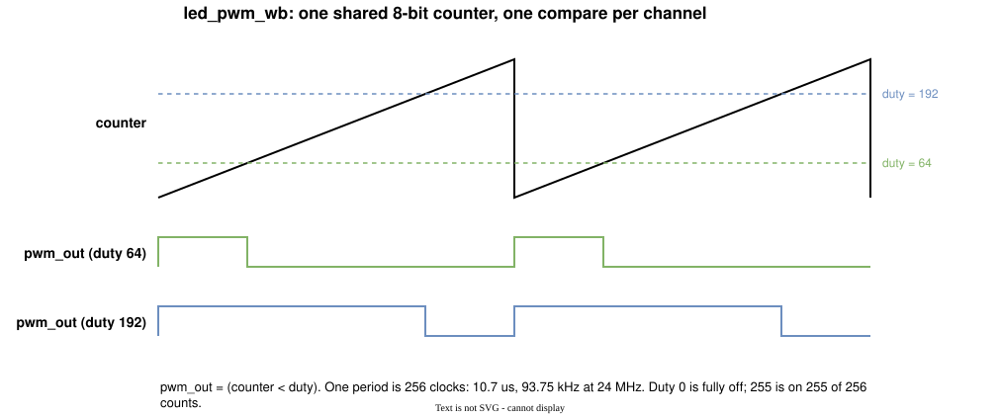

# 4. LED PWM and software interrupts

## The idea: the smallest useful device

`led_pwm_wb` is Beresheet's own device, written to be the template for adding
one: a Wishbone slave with a few registers, a little hardware that does
something on its own, and an output to the outside world. It is about a hundred
lines of Verilog.

It does two unrelated jobs, because it is the SoC's general-purpose register
block:

1. it dims LEDs with **pulse-width modulation (PWM)**;
2. it has a **SWIRQ** register whose bits drive PLIC interrupt sources 2 to 5
   directly, so software can raise a real external interrupt on demand.

## PWM

An LED cannot be "half on", but it can be switched on for half the time, faster
than the eye can follow. The fraction of time it is on is the **duty cycle**,
and the eye reads it as brightness.

The hardware is one free-running 8-bit counter shared by all channels, and one
comparator per channel:

```verilog
assign pwm_out[c] = (counter < duty[c]);
```



- Duty 0 means fully off. Using `<` rather than `<=` matters: with `<=`, duty 0
  would still light the LED for one count in 256, visible in a dark room.
- Duty 255 means on for 255 of every 256 counts.
- A period is 256 clocks: 10.7 us, a PWM frequency of 93.75 kHz at 24 MHz.

The design choice is the point of the example: the fast, regular switching is
done in hardware, and software only changes a duty value when it wants a new
brightness (the BIOS LED animation does so from its timer interrupt). Doing the
switching in software would need an interrupt every few microseconds.

All channels switch on together at the start of each period. That is fine for
LEDs; a design driving motors or other inductive loads would stagger the phases
to spread the current.

On the Tang Nano 20K the LEDs are active low, so the top level inverts the
outputs. `led[0]` is a hardware heartbeat that blinks whenever the bitstream is
running; channels 1 to 5 of the PWM block drive `led[5:1]`. Channel 0 exists
in the block but is not routed to a pin.

## SWIRQ: interrupts on demand

Each bit of the SWIRQ register is wired straight to a PLIC source:

| SWIRQ bit | PLIC source |
|-----------|-------------|
| 0 | 2 |
| 1 | 3 |
| 2 | 4 |
| 3 | 5 |

Writing 1 to a bit raises that source's line (level-sensitive, like a real
device); writing 0 lowers it. This makes it possible to exercise the PLIC's
priority, threshold and claim/complete logic, and the whole interrupt path into
the core, without a device having to misbehave first. The BIOS PLIC self-test
uses source 2 this way, and its handler "services" the source by clearing the
bit before completing it (`plic_service` in `firmware/bios/trap.c`).

## Register map

Base `0x1100_0000`, 32-bit word accesses (only the low bits are used):

| Offset | Register | Bits used | Access |
|--------|----------|-----------|--------|
| `0x00` | LED0 duty | 7:0 | read/write |
| `0x04` | LED1 duty | 7:0 | read/write |
| ... | one word per channel | | |
| `0x14` | LED5 duty | 7:0 | read/write |
| `0x20` | SWIRQ | 3:0 | read/write |

Other offsets in the 64-byte window read as zero. All registers reset to 0.

The device tree lists the block (`compatible = "beresheet,led-pwm"`) only so
that its address range is described; Linux has no driver for it.

## Where this is in the RTL

| What | File | Key signals |
|------|------|-------------|
| The device | `RTL/peripherals/gpio/led_pwm_wb.v` | `counter`, `duty`, `pwm_out`, `swirq`, `IDX_SWIRQ`, `idx`, `sel` |
| Instance and SWIRQ to the PLIC | `RTL/soc/soc_wb.v` | `leds`, `swirq`, `plic_src` |
| Board pins and heartbeat | `RTL/fpga/tangnano20k/top_tang_nano_20k.v` | `led`, `status`, `beat` |
| BIOS helpers | `firmware/bios/leds.h`, `plic.h` | `LED_BASE`, `GPIO_SWIRQ`, `plic_swirq_set`, `plic_swirq_get` |
