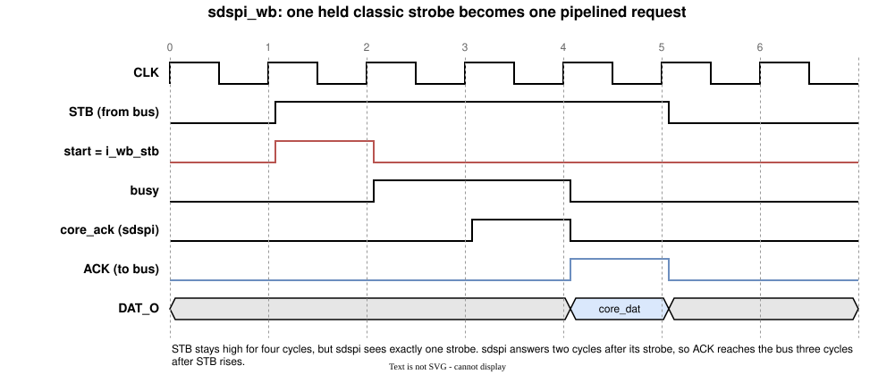

# 5. SD card over SPI

## The idea: the boot disk

The BIOS fits in 32 KB of block RAM; Linux, OpenSBI, the device tree and the
root file system together are several megabytes. They live on a microSD card,
and the BIOS copies them into SDRAM at boot. Changing what the board boots
means copying files to the card, not rebuilding the FPGA.

SD cards speak two protocols: their native 4-bit SD bus, and a simpler **SPI
mode** that every card must support. SPI needs four wires (chip select, clock,
data out, data in) and is slow but easy. Beresheet uses SPI mode.

## Third-party RTL, and a small adapter

The controller is **sdspi** by Dan Gisselquist (ZipCPU, Gisselquist
Technology), distributed under the **GNU General Public License, version 3 or
later** (see the header of each file). The five controller files (`sdspi.v`,
`llsdspi.v`, `spicmd.v`, `spirxdata.v`, `spitxdata.v`) are unmodified upstream
RTL. The controller sends commands, collects responses, moves 512-byte sectors
through two internal FIFOs, and generates the SPI clock.

Beresheet's own wrapper, `sdspi_wb.v`, solves one real mismatch. `sdspi` is a
Wishbone **pipelined** slave: it treats *every* cycle with STB high as a new
request. Beresheet's bus is **classic**: the master holds STB high until ACK.
Connected directly, every access would happen two or more times: a command
written twice is two SD commands, a FIFO read twice skips a word. The wrapper
turns the held strobe into a single one-cycle `start` pulse and holds the
answer until the master takes it.



The wrapper also ties off two inputs: `i_bus_grant = 1` (the SPI bus is not
shared) and `i_card_detect = 1` (the Tang Nano's socket has no card-detect
switch, so the card is assumed present; the controller still notices a missing
card from its lack of responses).

## Registers

Four 32-bit registers at base `0x1200_0000`, in the controller's own layout:

| Offset | Name | Use |
|--------|------|-----|
| `0x0` | CMD | Write: start a command (SD command number in the low bits, control flags above). Read: status (busy, error, card removed, ...) |
| `0x4` | DATA | Command argument before a command; response word after it. Also carries the "aux" configuration word (sector size, clock divider) |
| `0x8` | FIFO A | Sector data, one 32-bit word per read, first card byte in the most significant lane |
| `0xC` | FIFO B | Second FIFO (unused by the BIOS) |

The bit definitions belong to the controller, not to the SD specification; the
BIOS names them in `firmware/bios/sdcard.c` (`SD_GO_CMD`, `SD_BUSY`,
`SD_ERROR`, `SD_FIFO_OP`, ...).

## The SPI clock

The SPI clock is derived from the system clock and a divider:

```
f_sck = f_clk / (2 x (div + 1))
```

| Phase | div | f_sck at 24 MHz |
|-------|-----|-----------------|
| Reset value, card initialisation (must be 100 to 400 kHz) | 119 | 100 kHz |
| After initialisation (`SD_SPEED_FAST`) | 1 | 6 MHz |

The reset value is computed in `soc_wb.v` from the clock frequency
(`SD_INIT_DIV = FREQ / (2 x 100 kHz) - 1`), so it stays correct if the system
clock changes. The controller also sends 256 clock cycles with chip select high
after reset (the SD specification asks for at least 74); a card that stayed
powered while the FPGA was reprogrammed needs that to return to a known state.

## How the BIOS uses it

The BIOS driver (`firmware/bios/sdcard.c`) is polled: it writes a command and
spins until the controller's busy flag clears. The interrupt output `o_int`
(a pulse when a command finishes) is wired to PLIC source 6 but nothing
enables it.

Initialisation follows the SD specification's SPI-mode sequence:

1. **CMD0** (go idle): reset the card into SPI mode.
2. **CMD8** with check pattern `0x1AA`: a version-2 card echoes it back.
3. **ACMD41** (CMD55 then CMD41, HCS set), repeated until the card leaves the
   idle state.
4. **CMD58**: read the OCR register; bit 30 (CCS) says whether the card is
   addressed in 512-byte blocks (SDHC/SDXC) or in bytes.
5. Switch the clock to 6 MHz.

A sector is read with **CMD17**, after which the 512 bytes are taken from FIFO
A as 128 word reads.

On top of that, `fat32.c` mounts the first FAT32 partition and finds files in
the root directory, and `boot.c` implements the boot:

1. read **`BOOT.TXT`** from the root directory;
2. for each line `role file address`, copy the file to that SDRAM address;
3. jump to the `sbi` file in machine mode with `a0` = hart id, `a1` = address
   of the `dtb` file, `a2` = the OpenSBI `fw_dynamic` information block, which
   names the `kernel` address as the next stage (entered in S-mode).

A `BOOT.TXT` for Linux might look like this. The file names are free; the
addresses match the [memory map chapter](../bus/05-memory-map.md):

```
# role   file             address
kernel   Image            0x80000000
load     rootfs.gz        0x80400000
dtb      beresheet.dtb    0x806F0000
sbi      fw_dynamic.bin   0x80700000
```

The default build does not boot; it **probes** the card instead: it
initialises it, lists the root directory, and prints the file `PROBE.TXT` if
present. That is a quick way to check the SD path on a new board.

Linux itself has no driver for this controller (the device tree does not list
it), and does not need one: its root file system is the initramfs the BIOS
already loaded.

## Where this is in the RTL

| What | File | Key signals |
|------|------|-------------|
| Wrapper | `RTL/peripherals/sdcard/sdspi_wb.v` | `start`, `busy`, `core_ack`, `wb_ack_o`, `INITIAL_CLKDIV` |
| Controller (upstream) | `RTL/peripherals/sdcard/sdspi.v`, `llsdspi.v`, `spicmd.v`, `spirxdata.v`, `spitxdata.v` | `r_sdspi_clk`, `o_wb_ack`, `o_int` |
| Instance, divider, IRQ | `RTL/soc/soc_wb.v` | `sdcard`, `SD_INIT_DIV`, `sd_irq` |
| BIOS driver and boot | `firmware/bios/sdcard.c`, `fat32.c`, `boot.c`, `boot.h` | `sd_init`, `sd_read_block`, `fat32_mount`, `boot_load_from_sd`, `boot_handoff` |
