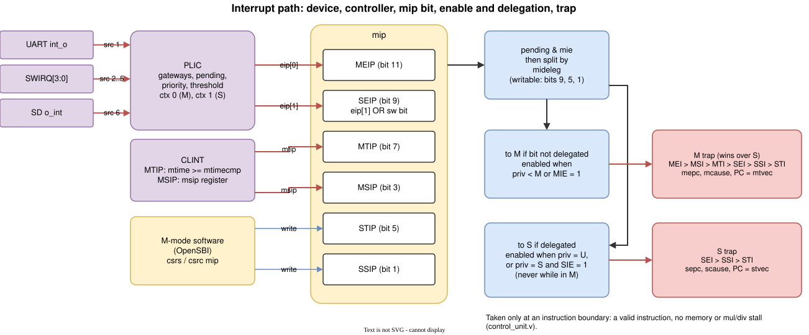

# 6. The interrupt path, end to end

## The idea: five stages from a pin to a handler

The previous chapters described each piece separately. This one follows a
single interrupt all the way, because most interrupt bugs live in the joints
between the pieces rather than inside any one of them.



| Stage | Where | What decides |
|-------|-------|--------------|
| 1. Device | UART, LED/SWIRQ, SD card | The device raises a **level** on its interrupt line and holds it until serviced |
| 2. Controller | PLIC or CLINT | PLIC: gateway, priority, enable, threshold per context. CLINT: `mtime >= mtimecmp`, `msip` |
| 3. Pending bit | `mip` CSR in the core | One bit per interrupt kind |
| 4. Enable and destination | `mie`, `mideleg`, `mstatus`, current privilege | Is it enabled? Does it go to M or to S? |
| 5. Trap | Control unit and CSR unit | At the next instruction boundary: save PC and cause, jump to the vector |

## Stage 3: the `mip` bits

`mip` (machine interrupt pending) has six bits in use. Some are wires from
outside the core, some are written by software:

| Bit | Name | Set by | Writable by software? |
|-----|------|--------|-----------------------|
| 11 | MEIP | PLIC context 0 (`eip[0]`) | no: clear it at the PLIC |
| 9 | SEIP | PLIC context 1 (`eip[1]`) **OR** a software bit | the software bit only |
| 7 | MTIP | CLINT comparator | no: move `mtimecmp` |
| 5 | STIP | software (M-mode) | yes |
| 3 | MSIP | CLINT `msip` register | no: write the CLINT |
| 1 | SSIP | software | yes (also via `sip` from S-mode, when delegated) |

The hardware bits follow their source wires combinationally; there is no latch
in the core. Clearing an interrupt therefore always means clearing its cause:
claim at the PLIC, move `mtimecmp`, write `msip` back to 0.

SEIP needs care. The value software reads is `eip[1] OR soft_bit`, but a
`csrs`/`csrc` on `mip` writes back what it read. If the hardware half were
copied into the software bit by such a read-modify-write, SEIP would stay set
after the PLIC dropped it, and the kernel would loop on an interrupt that no
longer exists. OpenSBI does exactly such a `csrs`/`csrc mip` on every timer
tick, so this happened. The CSR unit now treats a SEIP that comes only from the
PLIC as 0 when it computes a `csrs`/`csrc` result (`rmw_seip_hw_only`), so the
software bit changes only when software sets or clears it on purpose.

## Stage 4: enable, delegation, priority

The control unit computes, every cycle:

```verilog
irq_active = mip & mie;            // pending and individually enabled
irq_to_m   = irq_active & ~mideleg;
irq_to_s   = irq_active &  mideleg;
```

`mideleg` (machine interrupt delegation) chooses the destination. Only bits 9,
5 and 1 (SEI, STI, SSI) are writable, so machine interrupts (MEI, MTI, MSI)
always go to M-mode. OpenSBI delegates the three supervisor interrupts to
S-mode before starting Linux.

Global enables depend on the current privilege, and the rule is asymmetric:

| Destination | Taken when |
|-------------|------------|
| M | running below M, or running in M with `mstatus.MIE = 1` |
| S | running in U, or running in S with `mstatus.SIE = 1`; never while running in M |

An interrupt for a *higher* privilege than the current one is always enabled.
Machine mode cannot be locked out of its machine by a kernel that cleared its
own enable bit.

If several are ready, an M-destined interrupt beats any S-destined one, and
within a destination the fixed priority is MEI, MSI, MTI, SEI, SSI, STI (M) or
SEI, SSI, STI (S).

## Stage 5: the trap

The interrupt is taken only at an **instruction boundary**: a valid instruction
in the decode/execute stage, no memory access or multiply/divide in progress,
and the CSR unit not in the middle of a write. The check is combinational on
`mip`, `mie` and `mstatus`, so a handler that re-enables interrupts can take a
pending one immediately, as the privileged specification requires.

Taking it means:

- `mepc` (or `sepc`) = the address of the instruction that has *not* executed
  yet, so returning with `mret`/`sret` resumes exactly there;
- `mcause` (or `scause`) = `0x8000_0000 | code`, where the top bit marks an
  interrupt and the code is the `mip` bit number (11, 9, 7, 5, 3 or 1);
- the previous privilege and interrupt-enable are saved in `mstatus`, and the
  enable is cleared;
- the PC jumps to `mtvec` (or `stvec`). Only direct mode is implemented: the
  low two bits of the vector read as 0, so every trap enters at the base
  address and the handler dispatches on the cause.

The [core part](../core/README.md) of this book covers the trap mechanism
itself.

## Example 1: bare metal, a SWIRQ interrupt (BIOS)

Everything runs in M-mode, `mideleg = 0`, and the PLIC's context 0 is used.

1. Setup: PLIC priority[2] = 5, threshold[0] = 0, enable[0] bit 2;
   `mie.MEIE = 1`; `mstatus.MIE = 1`.
2. Software writes 1 to SWIRQ bit 0. PLIC source 2 goes high.
3. Gateway 2 sets pending[2]; 5 > 0, so `eip[0]` rises; `mip.MEIP` = 1.
4. At the next instruction boundary the core traps: `mcause = 0x8000_000B`.
5. The handler (`plic_service`) claims (reads 2; `eip[0]` falls), clears SWIRQ
   bit 0 (the "device" lowers its line), completes 2, and returns with `mret`.

## Example 2: Linux, a key press

The UART is on PLIC context 1, SEI is delegated, and the CPU is running a user
program in U-mode.

1. A byte arrives; the UART raises `int_o` (receive data or timeout).
2. Gateway 1 sets pending[1]; `eip[1]` rises; `mip.SEIP` = 1.
3. SEI is delegated and the hart is in U-mode, so it traps to S-mode:
   `scause = 0x8000_0009`, PC = `stvec`.
4. Linux's PLIC driver claims context 1 (reads 1), calls the 8250 handler,
   which empties the receive FIFO (the UART lowers `int_o`), then completes 1.
5. `sret` returns to the user program.

M-mode and OpenSBI are not involved at all. The
[PLIC chapter](02-plic.md) shows this sequence as a diagram.

## Example 3: Linux, a timer tick

The core has no Sstc extension, so Linux in S-mode cannot program a timer
compare register of its own. OpenSBI relays the timer:

1. Linux calls `sbi_set_timer(t)` (an `ecall` into M-mode). OpenSBI writes
   `mtimecmp = t`, clears `mip.STIP` and enables `mie.MTIE`.
2. When `mtime` reaches `t`, MTIP rises. MTI is never delegated, so the hart
   traps to M-mode (`mcause = 0x8000_0007`) even though Linux is running.
3. OpenSBI's handler disables `mie.MTIE` (MTIP is still high, since nobody has
   moved `mtimecmp`) and sets `mip.STIP`, then returns with `mret`.
4. STI is delegated, so the pending STIP now traps to S-mode
   (`scause = 0x8000_0005`): Linux's timer interrupt.
5. Linux handles the tick and calls `sbi_set_timer` for the next one, which
   brings us back to step 1.

Every Linux timer tick is therefore two traps and an `ecall`. That is the
price of the single-hart, no-Sstc design, and it is the reason the `mip`
read-modify-write detail above mattered so much: step 3 and step 1 touch `mip`
on every tick.

## Where this is in the RTL

| What | File | Key signals |
|------|------|-------------|
| Interrupt wires into the core | `RTL/soc/soc_wb.v` | `irq_soft`, `irq_timer`, `plic_eip[0]` (`irq_ext`), `plic_eip[1]` (`irq_ext_s`) |
| `mip`, `mie`, `mideleg` | `RTL/core/CSR_unit.v` | `mip_val`, `mip_seip_sw`, `mip_stip`, `mip_ssip`, `rmw_seip_hw_only`, `MIDELEG_MASK` |
| Enable, destination, priority, boundary | `RTL/core/control_unit.v` | `irq_active`, `irq_to_m`, `irq_to_s`, `m_irq_enabled`, `s_irq_enabled`, `irq_boundary`, `irq_code` |
| Bit numbers and cause codes | `RTL/core/CSRdefinitions.vh` | `IRQ_*`, `CAUSE_IRQ_*` |
| PLIC and CLINT | `RTL/peripherals/plic/plic_wb.v`, `clint/clint_wb.v` | `eip`, `mtip`, `msip` |
| BIOS handler | `firmware/bios/trap.c` | `trap_handler`, `plic_service` |
| Device tree wiring | `firmware/dts/beresheet.dts` | `interrupts-extended` on the CLINT and PLIC, `interrupts = <1>` on the UART |
